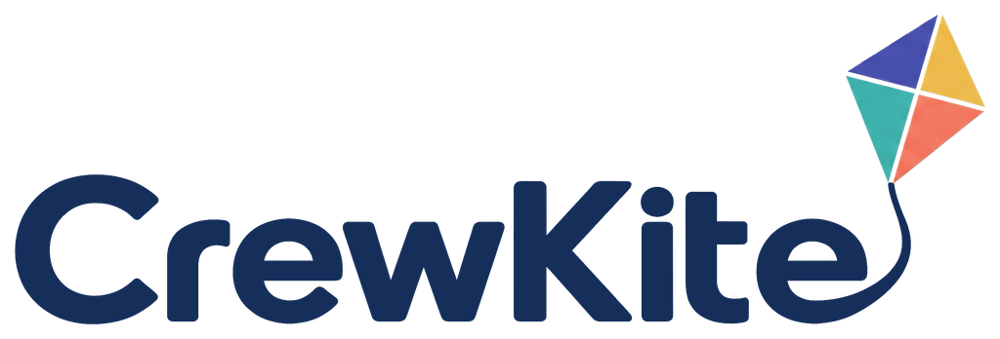

# CrewKite

<picture>
  <source media="(prefers-color-scheme: dark)" srcset="apps/desktop/src/renderer/assets/crewkite-wordmark-inverse.png">
  
</picture>

CrewKite is a local workspace for the coding agents you already pay for. It runs Google, OpenAI, Anthropic and Local models through their own clients (Antigravity CLI, Codex, Claude Code and LM Studio) as threads on your own computer, each signed in with your own plan. A thread can move from one provider to another and keep its messages and its edited files.

CrewKite by Roots No Limits LLC. Created by Raymond J. Kraft.

## Why CrewKite

- Use the plans you already pay for. CrewKite runs each provider's own signed-in client, sets no API key and adds no plan of its own.
- Keep working when a limit hits. A thread moves to another provider mid task with its messages and edited files, by hand or by the handoff rule you pick.
- See every allowance in one place. The rail shows the five-hour and weekly windows each provider reports, or the weekly and model windows for a plan with no five-hour limit, and Local shows no limit.
- Split large work across providers. An orchestrator proposes up to 8 slices, the controller assigns each one by allowance and difficulty, and a reviewer, fixer and challenger check the result.
- Review before anything lands. Each thread works in its own copy of the repository. You read the diff, accept or discard each hunk, and Accept makes a new local branch while your checkout stays as it was.
- Approve what runs. Commands, edits and tool calls ask first unless your policy allows them, and subagents a provider starts show under the step that started them.
- Run your tests on demand. Run tests runs the project's test command in the thread's copy and shows the exit status and output, with no model involved and no credits spent.
- Run a local model beside the cloud ones. An LM Studio model assigned to a crew role takes slices that fit its context, at no cost beyond your hardware.
- Work on large repositories. A thread's copy has no file count cap and checks free disk space before it starts.
- Keep your work on your computer. CrewKite has no account, sends no telemetry and hosts nothing. It is Apache 2.0.

## Status

CrewKite 0.1.0 is its first public release. I ran all four families, Google, OpenAI, Anthropic and Local, live through development. The release build gets a final check on macOS before it ships.

<!-- Release screenshot pending the installed-build launch checks. -->

A crew can work a large request in slices. In the Full crew preset an orchestrator model reads the request and proposes a plan of up to 8 slices. The controller checks the plan and assigns each slice to the crew's builder or its fixer for a hard slice. Local takes a slice only when a crew role uses Local and the slice fits its context. Any model can read what another did through read-only thread tools.

## Install

Installed packages are in preparation. Their signing, first-open and Linux launch checks remain pending. The [distribution notes](docs/distribution.md#installed-distribution-in-progress) describe the fixed state paths and qualification limits. Version 0.1.0 starts fresh installed state; directory-preview import and rollback qualification wait for 0.1.1.

From source:

1. Install Node 24.22.0 and pnpm 12.11.2.
2. Run `pnpm install`, then `pnpm desktop:install` to download the Electron binary.
3. Run `pnpm demo` to open the desktop on a synthetic project with scripted providers. To use your own clients on Apple silicon, stage a package with `node scripts/package.mjs --id my-build` and open `bin/desktop` in the folder it prints. The script expects the pinned Node binary under `internal/tools` and a committed working tree.

To try a published build without the source, follow the [preview guide](docs/preview.md). Connect each provider once from its card. OpenAI signs in through CrewKite's own client home; the person's existing client sign-in stays separate. Later launches reconnect providers that were connected before.

Check for Updates… sits under About in the CrewKite menu on macOS and in Help on Linux. CrewKite also checks once a day after launch and offers a newer release's download page. Updating is a manual download in 0.1.x.

OpenAI compatibility follows its protocol checks and replies; version 0.133.0 introduced the named read profile. Anthropic accepts builds from 2.1.259 within its tested major, and the Google quota reader accepts builds from 1.4.0 within its tested major. Settings shows the found version and its checked-build date. [Provider routes](docs/providers.md#client-versions) lists tested builds, update commands and setup.

## Platforms

- macOS on Apple silicon runs all four families.
- Linux x64 and arm64 run OpenAI, Anthropic and Local in a preview. Google, task writers, formatting and verification stay on macOS for now.
- Windows does not run CrewKite yet.

### Why no Windows yet

CrewKite's safety rests on POSIX behavior. Each provider client runs in its own process group, so Stop ends it and everything it started. The control socket is a Unix domain socket that only your user can open. Every client binary passes owner and permission checks before it runs, and file reads and writes refuse links that lead out of the working copy. Windows answers each of these differently, with job objects, named pipes and access control lists, so the port rewrites that whole layer. I will not ship Windows with weaker versions of these checks. The port is in progress, and Windows ships when it enforces what macOS and Linux enforce today. WSL2 is untested.

## Plans per family

CrewKite puts no plan gate of its own. Each family works on whatever plan its provider allows, and the provider's limits apply. CrewKite sets no API key and never falls back to paid API billing. The OpenAI route stops with a message when its client is signed in with an API key, because that bills per token. [Provider routes](docs/providers.md#plans-per-family) has the longer notes on each line.

| Family | Account | Plan facts |
|--------|---------|------------|
| OpenAI | The OpenAI account its client is signed in with | As of 31 October 2026, OpenAI says its coding client is included in its Free, Go, Plus, Pro, Business, Edu and Enterprise plans. Usage limits depend on the plan, the model and the task. |
| Anthropic | The Anthropic account its client is signed in with | As of 31 October 2026, Anthropic includes its coding client in its Pro, Max, Team and Enterprise plans and leaves it out of Free. Pro and Max have a five-hour limit and a weekly limit that the Anthropic chat app shares. On 6 November 2026 Anthropic removed the five-hour limit from Ultra (formerly Max 20x); its weekly limit still applies, and its row shows the weekly window and the model's own weekly window, such as Fable. |
| Google | Your personal Google account | As of 31 October 2026, Google gives accounts without a paid plan a quota that refreshes weekly. Google AI Pro refreshes every five hours until a weekly limit, and Google AI Ultra has the highest quota. Limits follow available capacity. |
| Local | LM Studio on this computer | As of 31 October 2026, LM Studio is free to use at home and at work. Speed and context follow your hardware. |

## Google and your account

Google's third-party access FAQ says that third-party access through its coding client login violates its terms. Its headless FAQ also excludes consumer CLI wrappers. The dated links are in [Google and your account](docs/providers.md#google-and-your-account). Google does not name CrewKite, and CrewKite has no exception from Google. Using the Google route is your own choice and your own risk. Settings shows this summary and keeps Connect Google off until you tick a box that says you have read Google's terms, accept the risk, and that Roots No Limits LLC is not liable for Google's actions against your account. The controller refuses Google use without that acknowledgement, and it asks again when this text changes.

## Roadmap

After 0.1.0, in rough order. [docs/roadmap.md](docs/roadmap.md) has the detail.

- Design systems, planned for 0.2.0 as a core feature. Configure a design system once and CrewKite enforces it on every provider. One reusable file names a project's tokens, its component library and its rules, such as the spacing steps and which raw values are banned. CrewKite can draft that file from an existing token source, and several projects can share one design system. Every crew role gets the same design brief whichever provider runs it, so a builder on OpenAI, a fixer on Google and a reviewer on Anthropic work to one standard. Before review, the controller checks each candidate in its own code: a token check flags raw colors, sizes and spacing, and a screenshot check renders the screens you list in both themes. A failed check blocks Accept and goes back to the fixer with the exact lines. CrewKite's own interface follows the same rules: shared components that take only design tokens, and a screenshot check of every provider card, the rail and the inspector tabs in both themes before a build is signed.
- GitHub in the thread, planned for 0.2.0, through your own GitHub sign-in. CrewKite already pushes a branch, opens a pull request and reads branch status. Next, the thread follows the pull request's CI as it runs: every check, its status and its log, with the failing step and lines pulled out. One click sends a failure to the fixer with that log excerpt, and the fix lands in the thread's copy for you to accept and push. Re-run failed jobs, read review comments in the thread, and squash merge with your own title, description and sign-off. The controller runs every GitHub step in its own code, and a merge first shows exactly what lands on the base branch and waits for your click.
- Named builders. A crew roster where each builder has its own provider, model and effort, with a live view of who works on which slice and the subagents each one starts.
- An API key route for each provider. It gives the full model list for Anthropic and a Google route inside Google's terms.
- Grok (xAI) as the other choice for the G row. Grok's own coding client speaks the same protocol as the Google route and signs in with your xAI subscription, so it would bring a fourth subscription family to Linux and to people who skip the Google route. It ships after I review xAI's terms and qualify Grok on macOS and Linux.
- Windows, once the port above is done.
- Google on Linux, plus Linux task writers, formatting and verification, alongside packaged Linux installers.
- Large repository work off the controller's main thread, and per-hunk review for large files.
- Project notes fetched when a model needs them, and routing that weighs context size beside allowance.
- Published bench results: tokens, time and checks passed per family on the same tasks.

## Why I built it

I build products for underserved niche markets, and I start each one by talking with the people who have the problem. Along the way I kept running into problems in my own workflow that no tool solved.

I work across several AI subscriptions and a local model, because each one is strongest at something different: backend work, frontend and design, or catching defects in review. Using them together on one repository meant separate apps and terminals, watching every usage meter, and writing handoffs by hand. Each new agent reread the whole context, and the style of the work drifted with every switch.

CrewKite is the controller I wanted: every provider in one thread, held to how I want my work done. Its review methods draw on open-source projects like multi, ADHD and Ponytail, [credited in the docs](docs/credits.md), so you get those ideas without having to find them first.

CrewKite is free and open source. Other people's open-source work has helped me a great deal, and this is my turn to give back. I am measuring efficiency with a benchmark now, and I will not claim gains until the numbers are in. Until then, what I want most is your feedback. My best product decisions have come from real people telling me what they need. Try it, and tell me where it falls short.

Raymond J. Kraft

## Principles

- Qualify official clients on their supported subscription path. Cloud-provider authentication stays with those clients, and CrewKite never reads or stores a provider credential. The one secret it can keep is the token of a model runtime on this device, only when I turn on Remember the Local token, and Forget removes it. CrewKite never falls back to paid API billing on its own.
- Report usage as observed. A gauge needs a real denominator, a source and a timestamp. Unknown is a valid state.
- Keep authority in code. Prompts and model output cannot grant permissions, raise limits or accept results.
- Preserve your source. Writers work in scratch copies. Results land as new local branches only.
- Keep the core small. Each new mechanism has to serve an enabled requirement or remove demonstrated work.

## Documentation

- [Preview walkthrough](docs/preview.md)
- [Uninstall](docs/preview.md#uninstall)
- [Architecture](docs/architecture.md)
- [Provider routes](docs/providers.md)
- [Usage and routing](docs/routing.md)
- [Continuity and recovery](docs/continuity.md)
- [Crew and permissions](docs/crew-and-permissions.md)
- [Testing approach](docs/testing.md)
- [Roadmap](docs/roadmap.md)
- [Releases](docs/releases.md)
- [Design history](docs/history.md)
- [Architecture decision records](docs/adr/README.md)

Read [CONTRIBUTING.md](CONTRIBUTING.md) before you open a pull request. The [credits and notices](docs/credits.md) record pinned sources and licenses. CrewKite is licensed under the Apache License 2.0. See [LICENSE](LICENSE).
