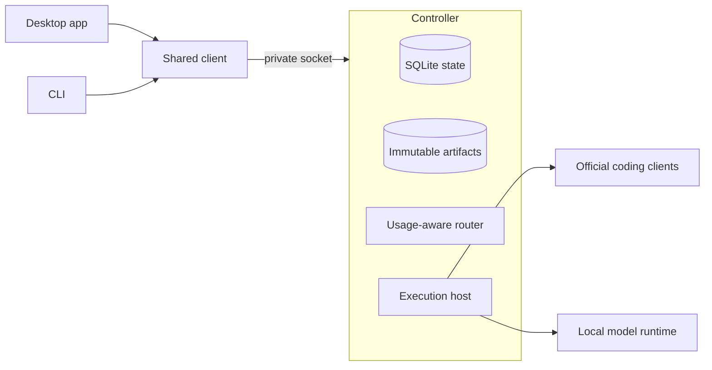

# CrewKite

CrewKite is a desktop workspace and CLI for coding with local models and the official coding clients from OpenAI, Anthropic and Google in one place. It shows what each subscription reports about usage and reset windows, assigns work using those limits, and keeps every task recoverable so another provider can continue it when one stops mid-task.

Status: early prototype. The first milestone runs the whole journey against scripted fake providers. No live provider route is qualified yet.

## Why I am building it

I build my products with a local model and three coding subscriptions. Each one lives in its own app with its own limits and reset schedule. When one runs low, I stop, write a handoff note by hand and paste it into the next tool. Weekly resets land on different days, so the best choice for a task changes through the week, and I track that in my head.

I want one workspace that knows those limits, routes work by them, and keeps the work safe when a provider stops. CrewKite is that workspace. I am building it for my own daily use first, in the open, and I will judge it by finished work and the manual coordination it removes.

## What the first release does

- Runs a task through one desktop window and one CLI that share the same controller, task IDs and history.
- Assigns roles (lead, orchestrator, coder, reviewer, advisor) to routes you have set up: local models and official subscription clients.
- Shows usage per route and window: remaining allowance, reset time, when it was observed and where the number came from. Missing data shows as unknown.
- Prefers routes whose allowance resets soon, protects reserves you set, and never spends just to empty a gauge.
- Records each task as durable facts and files, so a successor route continues from the work itself. A final summary from the stopped model is optional.
- Works in scratch copies of your repository. Accepting a result creates one new local branch. Your checkout, remotes and deployments stay untouched.

## How it fits together

The controller is a headless Node process. It owns permissions, budgets, task ownership, evidence and acceptance. Models propose plans and edits. Deterministic code decides what runs. [docs/architecture.md](docs/architecture.md) covers the boundaries.

## Principles

- Use the official clients on your own subscriptions. CrewKite never reads, copies or proxies provider credentials, and it never falls back to paid API billing on its own.
- Report usage as observed. A gauge needs a real denominator, a source and a timestamp. Unknown is a valid state.
- Keep authority in code. Prompts and model output cannot grant permissions, raise limits or accept results.
- Preserve your source. Writers work in scratch copies. Results land as new local branches only.
- Keep the core small. Each new mechanism has to serve an enabled requirement or remove demonstrated work.

## Roadmap

| Milestone | Outcome | Status |
|-----------|---------|--------|
| D0 | Desktop and CLI run the full task journey against fake providers | In progress |
| D1a | One qualified official client does useful supervised work with manual export | Planned |
| D1b | Checked results: immutable candidates, independent checks and review, local branch acceptance | Planned |
| D2 | Local, OpenAI, Anthropic and Google routes with handoff, honest usage and two-slice parallel work | Planned |
| D3 | Signed, documented distribution for a stated audience | Planned |

Details live in [docs/roadmap.md](docs/roadmap.md).

## Run the prototype

Setup instructions arrive with the D0 prototype. The reference platform is macOS on Apple Silicon with Node 24 and pnpm.

## Documentation

- [Architecture](docs/architecture.md)
- [Usage and routing](docs/routing.md)
- [Continuity and recovery](docs/continuity.md)
- [Provider routes](docs/providers.md)
- [Testing approach](docs/testing.md)
- [Design history](docs/history.md)
- [Architecture decision records](docs/adr/README.md)

## Contributing

Read [CONTRIBUTING.md](CONTRIBUTING.md). Branch names, commit messages and documentation style are checked in CI.

## License

Apache License 2.0. See [LICENSE](LICENSE).
