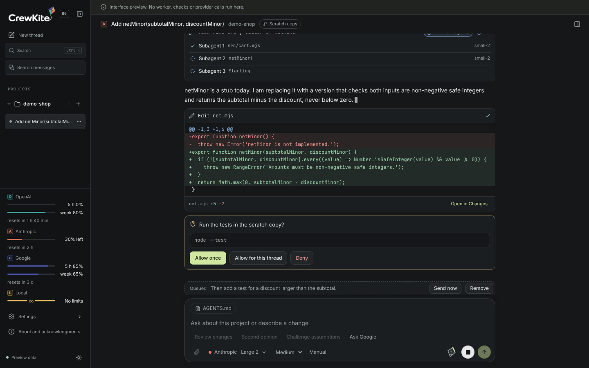

# CrewKite

<picture>
  <source media="(prefers-color-scheme: dark)" srcset="apps/desktop/src/renderer/assets/crewkite-wordmark-inverse.png">
  
</picture>

CrewKite is a local workspace for the coding agents you already pay for. It runs the OpenAI, Anthropic and Google clients you have signed in, and a local model, as threads on your own computer. A thread can move from one provider to another and keep its messages and its edited files.

CrewKite by Roots No Limits LLC. Created by Raymond J. Kraft.

## Status

CrewKite is a prerelease, version 0.1.0. I ran all four families, OpenAI, Anthropic, Google and Local, live through development. The release build gets a final check on macOS before it ships.

A crew can work a large request in slices. In the Full crew preset an orchestrator model reads the request and proposes a plan of up to 8 slices. The controller checks the plan, assigns each slice by allowance and difficulty, and runs it. Builders on any family run the slices, and any model can read what another did through read-only thread tools. Local takes the easy slices that fit its context.

## Install

1. Install Node 24.22.0 and pnpm 12.11.2.
2. Run `pnpm install`, then `pnpm desktop:install` to download the Electron binary.
3. Run `pnpm demo` to open the desktop on a synthetic project with scripted providers. To use your own clients on Apple silicon, stage a package with `node scripts/package.mjs --id my-build` and open `bin/desktop` in the folder it prints. The script expects the pinned Node binary under `internal/tools` and a committed working tree.

To try a published build without the source, follow the [preview guide](docs/preview.md). Each provider needs its own client, signed in on your machine. Chat accepts a range of client builds within the major version I tested: OpenAI from 0.163.0 (tested with 0.163.0), Anthropic from 2.1.0 (tested with 2.1.302) and the Google quota reader from 1.4.0 (tested with 1.4.2). Settings names the version it found. [Provider routes](docs/providers.md#client-versions) lists the update command for each and the setup.

## Plans per family

CrewKite puts no plan gate of its own. Each family works on whatever plan its provider allows, and the provider's limits apply. CrewKite sets no API key and never falls back to paid API billing. The OpenAI route stops with a message when its client is signed in with an API key, because that bills per token. [Provider routes](docs/providers.md#plans-per-family) has the longer notes on each line.

| Family | Account | Plan facts |
|--------|---------|------------|
| OpenAI | The OpenAI account its client is signed in with | As of 31 October 2026, OpenAI says its coding client is included in its Free, Go, Plus, Pro, Business, Edu and Enterprise plans. Usage limits depend on the plan, the model and the task. |
| Anthropic | The Anthropic account its client is signed in with | As of 31 October 2026, Anthropic includes its coding client in its Pro, Max, Team and Enterprise plans and leaves it out of Free. Pro and Max have a five-hour limit and a weekly limit that the Anthropic chat app shares. |
| Google | Your personal Google account | As of 31 October 2026, Google gives accounts without a paid plan a quota that refreshes weekly. Google AI Pro refreshes every five hours until a weekly limit, and Google AI Ultra has the highest quota. Limits follow available capacity. |
| Local | LM Studio on this computer | As of 31 October 2026, LM Studio is free to use at home and at work. Speed and context follow your hardware. |

## Google and your account

Google's third-party access FAQ says that third-party access through its coding client login violates its terms. Its headless FAQ also excludes consumer CLI wrappers. The dated links are in [Google and your account](docs/providers.md#google-and-your-account). Google does not name CrewKite, and CrewKite has no exception from Google. Using the Google route is your own choice and your own risk. Settings shows this summary and keeps Connect Google off until you tick a box that says you have read Google's terms, accept the risk, and that Roots No Limits LLC is not liable for Google's actions against your account. The controller refuses Google use without that acknowledgement, and it asks again when this text changes.

## Principles

- Qualify official clients on their supported subscription path. Cloud-provider authentication stays with those clients, and CrewKite never reads or stores a provider credential. The one secret it can keep is the token of a model runtime on this device, only when I turn on Remember the Local token, and Forget removes it. CrewKite never falls back to paid API billing on its own.
- Report usage as observed. A gauge needs a real denominator, a source and a timestamp. Unknown is a valid state.
- Keep authority in code. Prompts and model output cannot grant permissions, raise limits or accept results.
- Preserve your source. Writers work in scratch copies. Results land as new local branches only.
- Keep the core small. Each new mechanism has to serve an enabled requirement or remove demonstrated work.

## Documentation

- [Preview walkthrough](docs/preview.md)
- [Uninstall](docs/preview.md#uninstall)
- [Architecture](docs/architecture.md)
- [Provider routes](docs/providers.md)
- [Usage and routing](docs/routing.md)
- [Continuity and recovery](docs/continuity.md)
- [Testing approach](docs/testing.md)
- [Roadmap](docs/roadmap.md)
- [Releases](docs/releases.md)
- [Design history](docs/history.md)
- [Architecture decision records](docs/adr/README.md)

Read [CONTRIBUTING.md](CONTRIBUTING.md) before you open a pull request. The [credits and notices](docs/credits.md) record pinned sources and licenses. CrewKite is licensed under the Apache License 2.0. See [LICENSE](LICENSE).
