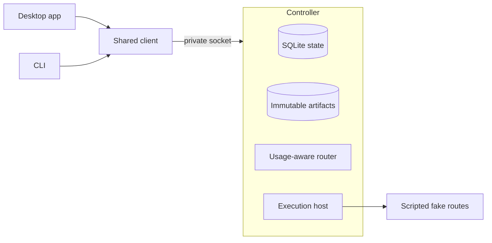

# CrewKite

<picture>
  <source media="(prefers-color-scheme: dark)" srcset="apps/desktop/src/renderer/assets/crewkite-wordmark-inverse.png">
  
</picture>

CrewKite is a desktop workspace and CLI for coding tasks that share one local controller. It tracks approvals, usage observations and retained work across provider routes.

Status: D0 prototype. The supported demo uses four scripted fake routes. No live provider route is qualified.

## Why I am building it

I build my products across three coding subscriptions. I want local models in the same workflow. Each subscription lives in its own app with its own limits and reset schedule. When one runs low, I stop, write a handoff note by hand and paste it into the next tool. Weekly resets land on different days, so the best choice for a task changes through the week, and I track that in my head.

I want one workspace that knows those limits, routes work by them, and keeps the work safe when a provider stops. CrewKite is that workspace. I am building it for my own daily use first, in the open, and I will judge it by finished work and the manual coordination it removes.

## Current prototype

- Runs a task through one desktop window and one CLI that share the same controller, task IDs and history.
- Uses editable teams with optional roles and a finite fake route, model and effort catalog.
- Shows fixture usage per route and window: remaining allowance, reset time, observation time and source. Missing data shows as unknown.
- Prefers routes whose allowance resets soon, protects reserves you set, and never spends just to empty a gauge.
- Records each task as durable facts and files, so a successor route continues from the work itself. A final summary from the stopped model is optional.
- Works in scratch copies of your repository. Accepting a result creates one new local branch. Your checkout, remotes and deployments stay untouched.

The qualified walkthrough uses the bundled synthetic project. Its real checks require the original test file and expected completions. Arbitrary repository checks remain unqualified. Review methods run as bounded jobs labeled SCRIPTED; their results establish fixture behavior and candidate binding. They do not establish model judgment.

## Workspace

Connected desktop running the synthetic demo with scripted fake routes.


<details>
<summary>Keyboard navigation</summary>

Press `Cmd+K` to open the command palette. Saved tasks show their project and task ID suffix, with five tasks per page. Previous and Next keep the rest reachable.

Review pending approval opens the existing approval card and focuses its review region. Read the exact target and consequence, then choose Approve once or Deny as a separate action. `Escape` closes the palette and dialogs. Arrow keys move between task and launch tabs.


</details>

## How it fits together



The controller is a headless Node process. It owns permissions, budgets, task ownership, evidence and acceptance. Models propose plans and edits. Deterministic code decides what runs. [Architecture](docs/architecture.md) covers these boundaries. Official subscription clients and local inference remain qualification targets in [provider routes](docs/providers.md).

## Principles

- Qualify official clients on their supported subscription path. Provider credentials stay with those clients. CrewKite never falls back to paid API billing on its own.
- Report usage as observed. A gauge needs a real denominator, a source and a timestamp. Unknown is a valid state.
- Keep authority in code. Prompts and model output cannot grant permissions, raise limits or accept results.
- Preserve your source. Writers work in scratch copies. Results land as new local branches only.
- Keep the core small. Each new mechanism has to serve an enabled requirement or remove demonstrated work.

## Roadmap

| Milestone | Outcome | Status |
|-----------|---------|--------|
| D0 | Desktop and CLI run the full task journey against fake providers | Local demo verified |
| D1a | One qualified official client does useful supervised work with manual export | Planned |
| D1b | Checked results: immutable candidates, independent checks and review, local branch acceptance | Planned |
| D2 | Local, OpenAI, Anthropic and Google routes with handoff, honest usage and two-slice parallel work | Planned |
| D3 | Signed, documented distribution for a stated audience | Planned |

Details live in [docs/roadmap.md](docs/roadmap.md).

## Run the prototype

The source demo requires Node 24.22.0, pnpm 12.11.2 and Git. The local desktop proof uses macOS on Apple Silicon. CI runs the full suite natively on macOS 15 with Chromium sandboxing enabled. Linux desktop startup remains unqualified. Local branch acceptance uses an existing configured Git identity; the demo does not change it.

```sh
pnpm install --frozen-lockfile
pnpm desktop:install
pnpm verify
export CREWKITE_HOME="$PWD/internal/demo-home"
export CREWKITE_PROFILE="$PWD/internal/desktop-profile"
pnpm demo
```

In another terminal, from the same checkout, select the same home:

```sh
CREWKITE_HOME="$PWD/internal/demo-home" pnpm crewkite task list --json
CREWKITE_HOME="$PWD/internal/demo-home" pnpm crewkite task watch <task-id> --json
```

Scripted observations intentionally become stale after five minutes. Before preparing a run after an idle period, you can explicitly choose Policy > Unknown usage > Allow selected routes within run limits. The displayed assigned routes use the shown finite limits. Stale labels, reserves and pins remain; percentage-based routing still requires fresh observations.

`pnpm verify` runs 30 tests, including the real desktop and CLI recovery journey, plus policy, lint, types and the desktop build. [Testing](docs/testing.md) separates fixed synthetic evidence, native OS interaction and package checks. The [local directory package](docs/distribution.md) carries its own Node and Electron runtime; Git remains a prerequisite.

## Documentation

- [Architecture](docs/architecture.md)
- [Usage and routing](docs/routing.md)
- [Continuity and recovery](docs/continuity.md)
- [Provider routes](docs/providers.md)
- [Testing approach](docs/testing.md)
- [Design history](docs/history.md)
- [Architecture decision records](docs/adr/README.md)

## Contributing

Read [CONTRIBUTING.md](CONTRIBUTING.md). Branch names, commit messages and documentation style are checked in CI.

## Credits

The review methods draw on Ponytail, ADHD and multi. The [credits and notices](docs/credits.md) record pinned sources, the adapted contribution ladder and licenses for bundled icons and fonts.

## License

Apache License 2.0. See [LICENSE](LICENSE).
