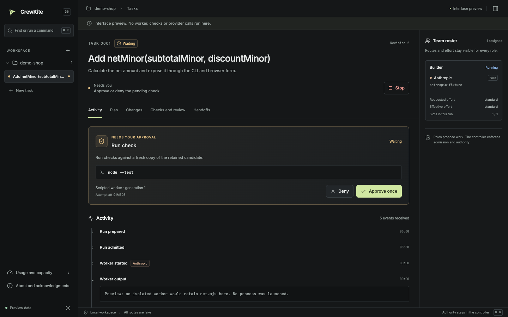
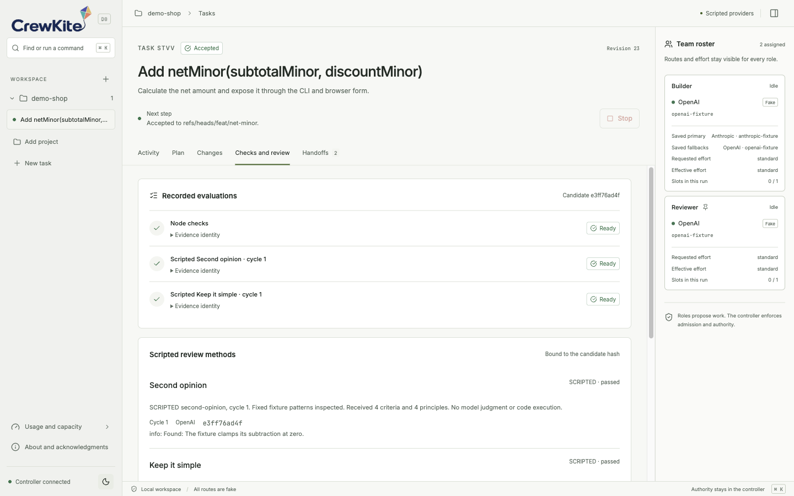
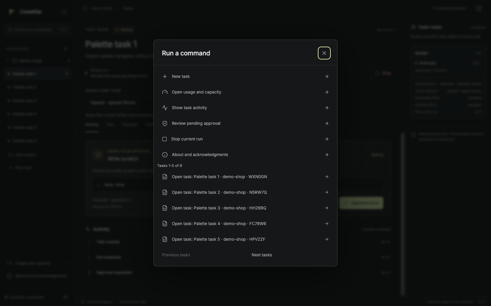
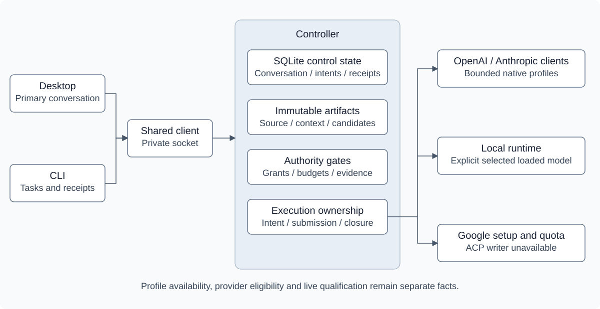

# CrewKite

<picture>
  <source media="(prefers-color-scheme: dark)" srcset="apps/desktop/src/renderer/assets/crewkite-wordmark-inverse.png">
  
</picture>

CrewKite is a desktop workspace and CLI for coding tasks that share one local controller. It tracks approvals, usage observations and retained work across provider routes.

Status: early prototype for macOS on Apple Silicon. The supported demo uses a synthetic project and four scripted fake routes. An opt-in OpenAI single-file pilot has passed normal desktop launch, CLI export and same-home package reopen. General live routing remains unqualified.

## Why I am building it

I build my products across three coding subscriptions. Each has its own interface, allowance and reset schedule. When one runs low, I stop to write a handoff and carry the context to the next tool. Weekly resets fall on different days, so the sensible place to run a task changes through the week. I keep that arithmetic in my head while trying to finish the work.

After upgrading my computer, I am exploring local AI alongside my subscriptions. I want to learn which jobs local models handle well and where a subscription route is more useful. My aim is to make that choice in the same interface, with the task and its history still in front of me.

Existing coding harnesses give me useful ways to work. CrewKite is an attempt to handle the coordination around them. I want useful work from the allowance I already pay for, with routing that considers reset times and the capacity I need to keep in reserve. That preference must stay within the permissions I set. I also want to choose which roles help on a task, without staffing a whole team for a small change.

The handoff matters as much as the routing. If a provider stops, I want the next one to receive the actual files and the evidence of what passed or failed, with unfinished work clearly marked. A final summary can help, but recovery should survive without it. [ADR 0007](docs/adr/0007-recover-from-durable-facts.md) records why I am building continuity around retained facts.

Community skills and plugins contain work I want to learn from and reuse. Finding the right ones and keeping up with changes takes attention. I want one consistent interface that explains what a tool does and the permissions it needs before I enable it. That should make reuse approachable for everyday AI users who have little interest in maintaining a collection of integrations. I intend to credit the original work and contribute useful improvements upstream where I can, with sources and licenses recorded in the [credits](docs/credits.md).

The scripted prototype exercises controller behavior. The bounded native single-file path has passed a supervised desktop launch and retained export, with offline coverage of its authority and recovery rules. Local inference and the skills and plugin experience remain planned. I am building in the open for my own daily use first. Finished work and less manual coordination will tell me whether this deserves a place alongside the tools I already use.

## Current prototype

- Runs a task through one desktop window and one CLI that share the same controller, task IDs and history.
- Uses editable teams with optional roles and a finite fake route, model and effort catalog.
- Shows fixture usage per route and window: remaining allowance, reset time, observation time and source. Missing data shows as unknown.
- Prefers routes whose allowance resets soon, protects reserves you set, and never spends just to empty a gauge.
- Records each task as durable facts and files, so a successor route continues from the work itself. A final summary from the stopped model is optional.
- Works in scratch copies of your repository. The qualified scripted journey can accept a result as one new local branch. Native single-file work stays available for inspection and manual export, with checks, review and acceptance disabled. Your checkout, remotes and deployments stay untouched.

The qualified walkthrough uses the bundled synthetic project. Its real checks require the original test file and expected completions. Arbitrary repository checks remain unqualified. Review methods run as bounded jobs labeled SCRIPTED; their results establish fixture behavior and candidate binding. They do not establish model judgment.

## Workspace

Connected desktop running the synthetic demo with scripted fake routes.





<details>
<summary>Keyboard navigation</summary>

Press `Cmd+K` to open the command palette. Saved tasks show their project and task ID suffix, with five tasks per page. Previous and Next keep the rest reachable.

Review pending approval opens the existing approval card and focuses its review region. Read the exact target and consequence, then choose Approve once or Deny as a separate action. `Escape` closes the palette and dialogs. Arrow keys move between task and launch tabs.



</details>

## How it fits together



The controller is a headless Node process. It owns permissions, budgets, task ownership, evidence and acceptance. Models propose plans and edits. Deterministic code decides what runs. [Architecture](docs/architecture.md) covers these boundaries. The first native profile has a bounded preparation and launch path. Its evidence and the remaining provider qualification gates are recorded in [provider routes](docs/providers.md).

## Principles

- Qualify official clients on their supported subscription path. Provider credentials stay with those clients. CrewKite never falls back to paid API billing on its own.
- Report usage as observed. A gauge needs a real denominator, a source and a timestamp. Unknown is a valid state.
- Keep authority in code. Prompts and model output cannot grant permissions, raise limits or accept results.
- Preserve your source. Writers work in scratch copies. Results land as new local branches only.
- Keep the core small. Each new mechanism has to serve an enabled requirement or remove demonstrated work.

## Roadmap

| Milestone | Outcome | Status |
|-----------|---------|--------|
| D0 | Desktop and CLI run the full task journey against fake providers | Local demo verified |
| D1a | One qualified official client does useful supervised work with manual export | Public launch and export verified |
| D1b | Checked results: immutable candidates, independent checks and review, local branch acceptance | In progress |
| D2 | Local, OpenAI, Anthropic and Google routes with handoff, honest usage and two-slice parallel work | Planned |
| D3 | Signed, documented distribution for a stated audience | Planned |

Details live in [docs/roadmap.md](docs/roadmap.md).

## Run the prototype

The source demo requires Node 24.22.0, pnpm 12.11.2 and Git. The local desktop proof uses macOS on Apple Silicon. CI runs the full suite natively on macOS 15 with Chromium sandboxing enabled. Linux desktop startup remains unqualified. Local branch acceptance uses an existing configured Git identity; the demo does not change it.

```sh
pnpm install --frozen-lockfile
pnpm desktop:install
pnpm verify
export CREWKITE_HOME="$PWD/internal/demo-home"
export CREWKITE_PROFILE="$PWD/internal/desktop-profile"
pnpm demo
```

In another terminal, from the same checkout, select the same home:

```sh
CREWKITE_HOME="$PWD/internal/demo-home" pnpm crewkite task list --json
CREWKITE_HOME="$PWD/internal/demo-home" pnpm crewkite task watch <task-id> --json
```

Scripted observations intentionally become stale after five minutes. Before preparing a run after an idle period, you can explicitly choose Policy > Unknown usage > Allow selected routes within run limits. The displayed assigned routes use the shown finite limits. Stale labels, reserves and pins remain; percentage-based routing still requires fresh observations.

For native work, create a project and draft task in the desktop. In Configure this run, choose Native file proposal. Enter the committed file path, review the consent and credit choices, then prepare and inspect the saved target before Start. The [single-file CLI setup](apps/cli/README.md#native-single-file-runs) covers the same preparation and launch through the CLI. Native trust and source consent are explicit or bound to an exact saved consent. Existing-credit spending defaults off. The result remains an unverified candidate that can be inspected and exported manually. The [provider notes](docs/providers.md) describe the fixed profile and billing limits.

`pnpm verify` runs the test suite, including the real desktop and CLI recovery journey, plus policy, lint, types and the desktop build. [Testing](docs/testing.md) separates fixed synthetic evidence, native OS interaction and package checks. The [local directory package](docs/distribution.md) carries its own Node and Electron runtime; Git remains a prerequisite.

## Documentation

- [Architecture](docs/architecture.md)
- [Usage and routing](docs/routing.md)
- [Continuity and recovery](docs/continuity.md)
- [Provider routes](docs/providers.md)
- [Testing approach](docs/testing.md)
- [Design history](docs/history.md)
- [Architecture decision records](docs/adr/README.md)

## Contributing

Read [CONTRIBUTING.md](CONTRIBUTING.md). Branch names, commit messages and documentation style are checked in CI.

## Credits

The review methods draw on Ponytail, ADHD and multi. The [credits and notices](docs/credits.md) record pinned sources, the adapted contribution ladder and licenses for bundled icons and fonts.

## License

Apache License 2.0. See [LICENSE](LICENSE).
