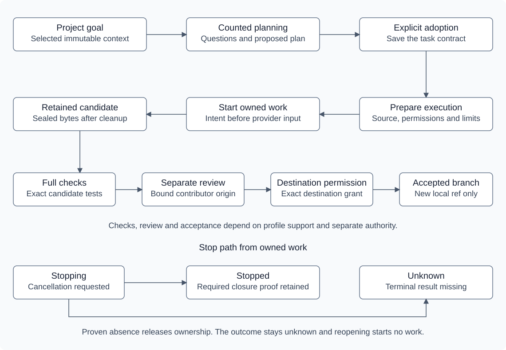

# Architecture

This page describes the current design. The reasoning behind each choice is in the [ADRs](adr/README.md).

## Components

| Component | Owns | Does not own |
|-----------|------|--------------|
| `apps/controller` | State, policy, routing, provider adapters, execution host, artifacts, evidence | Trust in model output as authority |
| `apps/desktop` | Electron main and preload, React renderer, native pickers, a narrow bridge to the client | Database access, provider launches, arbitrary shell or file APIs |
| `apps/cli` | Human commands, JSON output, offline diagnostics | A second permission, acceptance or database write path |
| `packages/contracts` | Runtime schemas, state and reason vocabularies, fixture contracts | Electron, database or provider code |
| `packages/client` | Handshake, typed commands, reconnect and replay, bounded reads | Domain transitions, provider protocols |
| `packages/testkit` | Fake provider executables, synthetic repositories, injected clocks, fault fixtures | Any production inference route |

Provider adapters stay inside the controller until a second consumer needs them. One integration owner lands changes to contracts, migrations, the lockfile and entry points, so the packages never drift apart.


A fresh normal workspace has no seeded project or fixture route catalog. Its prepared native profiles and explicit Local connection use their real provider protocols. Developer demo and preview modes remain explicit. A failed native operation retains its own refusal or uncertainty; it grants no fallback authority.

## Task conversation

The task's primary conversation retains messages, queued guidance, questions, answers and proposed plans with their run and attempt bindings. A planning turn needs explicit consent, the supported primary profile and finite limits. The current selection permits Lead or Orchestrator through `openai-file-v1`, with a separate existing-credit choice. Requested model and effort remain distinct from observed effective settings. Planning consumes the task's budget; reading history, reconnecting and reopening admit no turn.

A completed planning turn can retain its bounded model catalog only after the reply is accepted and every owned phase is quiescent. The immutable artifact binds the task, attempt, supported profile and exact client identity. Its public projection reports last-observed choices and time, with no local path or account identifier. Reading the catalog admits no provider work. A changed client or invalid artifact makes the choices stale or unavailable.

Saving an exact advertised model and effort requires the existing quiescent configuration boundary. A material change records the observation reference and creates a linked future planning run without launching a provider or resetting the task's allowance. It returns the task contract to provisional, so execution preparation requires a fresh valid plan adoption. The next admitted turn rechecks the current advertised pair, account and credit policy, then requires exact model and effort acknowledgement before its prompt. Failure retains the request and leaves effective settings unknown. There is no fallback or automatic refresh. Without a saved request, the supported profile default remains available for the first turn.

The future execution policy control supplies a revision-bound preparation draft. The host checks its task and planning configuration before opening the real preparation form. Authority changes clear unsaved sharing and grant confirmations. Explicit preparation freezes the supported policy; opening or closing a draft grants nothing. Existing prepared and running work keep their frozen policy. Planning remains read-only and tool-free.

Adopting a plan binds its exact proposal ID and hash to the task contract. It grants no execution authority. Execution still needs its own prepared source, policy, permissions and Start. Guidance received during active work is retained for a later explicitly admitted planning turn. Model text cannot approve an effect, raise a limit or accept a result. The renderer projects current send and adoption availability from controller reads and keeps uncertain command receipts for exact retry.

Selected context is immutable input data. The controller captures committed source files or folders at the chosen base, and explicitly selected project-local logs from current disk bytes. It accepts up to four selections, 32 files, 8 KiB per file and 32 KiB for the complete encoded bundle. Links, unsupported text and excluded credential paths refuse. The artifact records the exact bytes, modes and hashes. The desktop's native picker keeps filesystem selection in main; its renderer validates the retained artifact for a content preview before the separate send decision. Capture retry resends the original command without reopening the picker; a committed result returns the same artifact. Conversation inputs reference those artifacts by ID and hash. Context supplies no filesystem, execution or approval authority. The composer shows only profile-supported controls. A context byte measurement cannot establish a provider token count or quota balance.

## Combined runs

A combined run freezes one parent and two child tasks from the same project and committed base. Each child owns one distinct existing text file and works in independent scratch. Preparation binds their task contracts, source, writer profiles, policy, selected tests and reviewer. The initial workflow uses Quick quality with one Keep it simple review under guided or balanced authority. Child work cannot be amended, transferred or accepted independently while that membership owns it.

The parent reserves seven dispatches: a baseline check, two writers, two ordered replay checks, a full final check and one fresh review. It needs at least seven attempts and two concurrent slots. Its minute allowance covers both writer maxima, the reviewer maximum and five minutes for the four checks and private integration work. Dispatches charge one shared ledger; child task limits remain additional gates. Earlier planning remains charged to its task. Missing closure keeps the reserved allowance charged. No stage receives an automatic retry or a larger budget.

The clean baseline must pass before either child can start. Assembly requires two substantive, in-scope candidates. It applies their exact deltas in order and checks each cumulative result before advancing a private integration ref with compare-and-swap. A durable operation journal owns the finite Git processes. The immutable origin binds both writers and candidates, source manifest, policy, criteria, replay definitions and results, and every old/new tree transition. Private integration changes no branch in the source repository.

The sealed combined candidate still needs an explicitly prepared full check and a separate native review of the whole result. Passing replay checks cannot replace that final barrier. The supported reviewer has its own source consent, credit choice and one-use grant within the parent's remaining allowance. Same-family review establishes process independence only. Destination-specific acceptance revalidates the complete origin and evidence chain before creating one new local branch. [Continuity](continuity.md#combined-ownership-and-recovery) describes parent controls and restart limits. [Proposed ADR 0026](adr/0026-bind-combined-acceptance-to-checked-origins.md) records the integration tradeoff.

## Processes and transport

The controller runs as one headless Node process per user. The desktop app and the CLI connect to it over a private Unix domain socket using length-prefixed JSON frames with a size limit.

- The socket lives in a directory only the user can read. Each connection presents a token from a user-only file during the handshake.
- The controller binds the actor to the connection. A caller-supplied actor ID is correlation data only.
- Provider processes and workers never receive the socket path or token.
- Clients that speak a different protocol version are rejected.

These measures keep other clients and workers off the control channel. They do not defend against malware running as the same user, and the docs make no such claim.

Native writer preparation includes per-phase ownership hooks and a SQLite journal for preflight and task processes. The journal separates launch intent, the actual process group and proven quiescence. OpenAI task success requires its complete three-phase sequence. The Anthropic writer records authentication followed by the task process. Historical Google consumer pilots recorded a zero-turn configuration read followed by the task process, with the submission marker before spawn because the prompt was in argv. New consumer launches remain blocked. Each successful writer requires its exact provider sequence; reviewers retain the OpenAI sequence. Historical short OpenAI sequences remain readable for recovery; incomplete sequences cannot authorize a successful application or publication. Legacy cloud recovery checks recorded groups; the separate Local, ACP and metadata rules below preserve missing closure proof as unknown. No native phase restarts automatically. A supervised native file proposal uses `PrepareNativeRun` to save an immutable preview without provider I/O. `StartRun` rechecks its installed profile, scoped consent and source before entering the same admission and process owner. Each prepared writer permits one submission. Anthropic and Google preparation freeze a user-sourced ordinary-subscription billing attestation separately from native observations. Missing required evidence or attestation blocks submission. Google also freezes the expected native permission mode; fresh configuration must match it and report disabled credit fallback. Configuration success establishes no account or billing identity. The writer and supported OpenAI reviewer resolve by their own saved profile IDs. Retained native work can be inspected and exported. Legacy writer resume, route switching and scripted continuation stay unavailable. Optional manual file handoff uses a frozen recipient list, fresh explicit consent and separate preparation and Start after proven quiescence. It preserves the original pin, roles and limits. This path has offline fixture coverage only; Google consumer launch remains blocked.

A separate repository profile prepares the complete committed source and explicit local-tool authority. The native client edits the independent scratch directly, using its workspace-write permission mode with approval requests and network access disabled. CrewKite trusts that client's permission system under ADR0009; it supplies no additional containment. The one-use scratch and native-tool grants are consumed together at admission, and the earlier expiry bounds execution. Native command and file-change activity is informational. It cannot establish a check result. After quiescence, the controller validates the resulting filesystem and captures its immutable candidate without reapplying a model response. A failed capture retains the scratch and reports interrupted, unverified work. Stop can retain partial changes; a completed capture receipt is required for evaluation. The existing file profiles and their application receipts keep their original behavior. This repository profile still needs connected qualification.

A separate candidate evaluation freezes its own scoped consent and reviewer assignment without changing the original run policy. The default recipe runs the trusted synthetic Node collection. An explicit project Node recipe selects up to 32 committed test files and freezes their exact bytes. Both run in an independent candidate copy through the existing local process owner. Passing checks retain evidence and wait for explicit `StartCandidateReview`. That command consumes the supplemental one-use review grant for one fresh native review within the original run's remaining attempt, minute and concurrency caps. The writer's fixed allowance is unchanged. Review input binds the immutable original and candidate bytes, task context, exact successful checks and reviewer profile. Repository review includes every changed text file, with explicit additions and deletions, and binds the whole candidate. Unsupported binary changes and an oversized review input remain retained and cannot pass that review. Review uses the same three-phase ownership journal and retains evidence only after quiescence. Same-family review establishes process independence only.

A native candidate becomes ready only after the exact checks and declared review method pass with proven ownership. Local acceptance revalidates the retained proof and current source through the existing publication path. Completed check evidence can survive a moved runtime when its saved definition digest is valid and the reporter bytes, evaluator, test collection, criteria and all other arguments are unchanged. The saved reporter path is never executed during publication validation. Pending checks and review starts keep exact current definitions. Expired inference consent or an unavailable provider account does not erase completed evidence. Creating a branch still requires its own current destination-specific acceptance grant or approval. The evaluation preview reports whether that local action can be requested; it grants no publication authority.

## Commands and events

Google contracts separate the default-on quota read from ACP setup and frozen model selections. `ObserveUsage` requests a read with `{ family: 'google' }`, without a consent field or enable/disable toggle. Separate ACP setup commands initialize, authenticate, discover configuration and stop the current operation. Their revision is the persisted setup revision. Safe proofs retain client and capability identity without credentials or OAuth URLs. Typed one-use permission targets and inert ACP activity preserve existing string targets and text output.

Quota and ACP setup share a durable metadata-operation journal, separate from task attempts. Intent precedes spawn; ownership and closed streams bind the result to that operation. Active or unknown Google ownership blocks another metadata operation and native Google Start in that controller home. Every unfinished metadata operation remains unknown across restart, without probing or signalling its historical process group. Nothing replays. With the pinned client present, controller startup attempts one read. An authenticated client connection can refresh missing, stale or unknown windows. Each admitted read has a sixty-second cooldown, including failure, and a twenty-second process bound. No timer refreshes quota. Failed reads preserve the prior window timestamps. Every returned bucket attaches conservatively to Google routes; the quota-only row has unknown model and effort and remains unqualified. A read cannot enable a writer. A thirty-second Start preflight can refresh missing or stale quota once. Fresh exhausted quota refuses without another read; final admission rechecks every bucket, reserve and current authority.

The ACP profile uses a separate task appointment and owned process phase. Preparation freezes its client pin, setup proof, configuration choices, source and explicit consent. Start reapplies the model, optional thought level and verified review mode before its single prompt. Production review-mode and edit-tool mappings bind one exact imported server/helper bundle, signer and version. Fresh setup proof must match that mapping; authentication and discovery alone grant no edit authority or route qualification. [Provider routes](providers.md#google-acp-writer) describes the fixed staging import and dated evidence.

An ACP permission request must map to one supported replacement. The complete action, including exact old and new text, must fit 4 KiB and remain bound by hash to one pending approval. A bounded hunk requires one exact match and binds the complete before and after file hashes. The controller rechecks the current target before approval and matches captured bytes to the approved result hash. A current human decision can select only the offered `allow_once` option for the exact session, tool call, task, attempt, generation and revision. The controller persists the decision before replying. Stop cancels pending requests and waits for the original prompt's cancelled response, closed streams and owned group absence. Missing terminal proof retains uncertainty and blocks capture.

The read-only task context is captured before Start, with a shared 64 KiB limit for its binding and complete retained patch. Private connector storage outside scratch binds it to the admitted run, source, policy, attempt, generation and configuration. Expected approval transitions preserve that capability; each read still validates the current owner. The provider receives no controller token. A completed writer captures actual scratch through a distinct receipt, with no second replacement application. The existing target must remain regular UTF-8 text within 64 KiB with its original mode. Every sibling path, byte and mode must match the admitted source. Provider diffs and connector sidecars remain activity, with no check, review or acceptance authority.

An ACP candidate uses the existing evaluation path with separate local-check authority. Its native reviewer still needs a supported OpenAI profile, scoped consent and grant, and remaining provider allowance within the original run limits. The Google writer's quota observations grant none of that reviewer capacity. Missing required review blocks acceptance.

Local setup stores a nonsecret connection revision, model observation and explicit selection. A dedicated loopback credential stays in controller memory and requires input again after restart. Discovery lists installed variants and loaded instances without loading a model. Preparation binds the selected eligible instance and runtime metadata to the source and policy, with no cloud billing attestation or credit policy. A durable Local operation excludes input, discovery and generation from conflicting. Intent precedes launch; matching terminal proof and recorded client closure settle ownership. Uncertain ownership survives restart without replay or historical process signalling. A completed Local file candidate has its own immutable preparation, terminal, applied replacement and closure evidence. Evaluation rechecks that origin against the current run, source and candidate before shared fixed checks and a separate OpenAI review. Matching evidence still needs destination-specific approval for branch acceptance. Restart can validate completed evidence without a current Local credential or connection; it never resubmits the writer. Live model qualification remains separate. [Proposed ADR 0025](adr/0025-use-an-explicit-memory-only-local-credential.md) records the dedicated credential boundary; cloud-provider credential handling stays separate.

Every mutation carries a protocol version, an idempotency key, the expected entity revision and a validated payload. The controller stores a digest of each request with its receipt.

- Retrying the same key with the same content returns the stored result.
- Reusing a key with different content is rejected.
- A stale revision returns `stale-revision` with the current state.

Results use a finite set of outcomes: `applied`, `already-applied`, `stale-revision`, `denied`, `unsupported`, `blocked` and `outcome-unknown`. Each carries a reason code and the safe next action.

Reads use snapshot plus subscription. `GetSnapshot` returns state at cursor C, and `Subscribe` replays ordered events after C. A gap in retained history forces a fresh snapshot. Slow clients are disconnected and resync; they never hold up work.

The candidate evaluation preview binds the current candidate and saved preparation to its check and review evidence. It shows the remaining original run budget and separate reasons for refusing each start action. Completed evidence stays visible after consent expires. Reading the preview creates no receipt or launch, and each start command rechecks current authority.

Explicit native profiles can propose a replacement for an existing committed text file through the desktop or CLI. Developer fixtures separately exercise legacy team routing. Its exact provider limits are in [Provider routes](providers.md). `ExportDiagnostics` returns `unsupported`. General live routing and installer recovery remain separate gates. The table describes the first-release command contract.

The command set for the first release:

| Command | Contract |
|---------|----------|
| `RegisterProject`, `InspectSource` | Explicit path selection, base revision, bounded dirty and untracked file details, stable project ID |
| `CreateTask`, `AmendTask`, `PrepareRun` | Saved criteria, versioned amendments, a frozen preview of source, routes, checks and limits |
| `CreateTaskDiscussion`, `ConfigureTaskConversation` | Explicit primary planning profile, role, credit choice and finite task limits |
| `SendTaskMessage`, `QueueTaskGuidance`, `AnswerTaskQuestion` | Retained input under current planning authority; active work queues guidance for a later turn |
| `AdoptTaskPlan` | Bind the exact retained proposal to the task contract without starting execution |
| `CaptureConversationContext` | Capture selected committed source or explicit project logs into a bounded immutable artifact |
| `ConfigureLocal`, `BeginLocalConnectionInput`, `RefreshLocalModels`, `SelectLocalModel`, `DisconnectLocal` | Explicit loopback setup, private credential input and observed model selection under the persisted Local revision |
| `PrepareCombinedRun` | Freeze a parent and two scoped children, shared dispatch allowances, checks and reviewer without starting work |
| `AssembleCombinedCandidate` | Replay both retained child deltas through ordered checks and guarded private ref updates; seal a candidate for separate final evaluation |
| `PrepareNativeRun` | Freeze a controller-owned file or repository profile, its committed source scope, task text, explicit or matching saved consent and policy; perform no provider I/O |
| `PrepareNativeHandoff`, `StartNativeHandoff` | Seal retained single-file work for one previously allowed recipient with fresh consent, then consume that exact preparation once after revalidation |
| `PrepareCandidateEvaluation`, `StartCandidateEvaluation` | Freeze supplemental authority for a stopped native candidate, then run its exact selected check recipe once; retain checks without starting review |
| `StartCandidateReview` | Recheck the successful candidate evaluation and separate reviewer authority, then start one bounded native review without applying files or accepting the candidate |
| `StartRun`, `GetSnapshot`, `Subscribe` | Atomic admission, consistent state with ordered events, no duplicate dispatch |
| `SwitchRoute` | Save an allowed coder target, stop the outgoing writer, seal retained work and recheck normal admission |
| `PauseAdmissions`, `StopRun` | Pausing stops new dispatch. Stopping requests cancellation and waits for proven quiescence |
| `ResolveApproval` | Binds the exact pending action, target, attempt, generation and revision |
| `ObserveUsage` | Read Google quota under the shared ownership gate and cooldown; preserve prior observations on failure |
| `InitializeGoogleAcp`, `AuthenticateGoogleAcp`, `DiscoverGoogleAcp` | Run one explicit setup operation under the shared Google gate and persisted setup revision; retain safe proof without a task prompt |
| `StopGoogleAcpSetup` | Revoke the current setup operation by its exact ID and persisted revision, request owned cleanup and retain unresolved ownership |
| `GetChanges`, `GetArtifact`, `GetUsage` | Bounded reads of immutable content and sourced usage observations |
| `AcceptCandidate` | Eligible candidate, current authority, an unused destination ref, idempotent publication |
| `GetHealth`, `ExportDiagnostics` | Runtime and qualification state; diagnostic export remains unsupported |

The controller exposes registered project and artifact IDs. It exposes no arbitrary shell, URL fetch or unrestricted file-read command. Public command payloads accept no connection credential value.

## State

Current-state tables in SQLite are authoritative. An ordered event log explains each transition. Large outputs and source snapshots are immutable files addressed by hash.

I model work as projects and tasks. A project registers the root of one Git repository, tying committed source and any accepted result branch to that repository. A task keeps one objective, its conversation, scoped permissions and retained evidence together. Workspace names the local application view. It adds no separate container or permission boundary.

| Entity | Meaning |
|--------|---------|
| Project | A registered repository with stable identity |
| Task | A bounded outcome with acceptance criteria |
| Run | A frozen revision of a task and its resolved policy |
| Attempt | One dispatch to one route, with a generation number |
| Route | A qualified combination of client, account, model, effort and billing mode |
| Observation | One usage reading for one route window, with source and time |
| Reservation | Capacity the controller holds for admitted work |
| Approval | A pending or resolved decision bound to one exact action |
| Artifact | Immutable content: diffs, logs, snapshots, handoff packets |
| Candidate | A sealed set of changes with a content hash |
| Receipt | The durable record of a command or effect |

The normal workflow keeps planning, execution and acceptance decisions separate. This diagram summarizes those boundaries; it is not a second state machine or a claim that every profile supports branch acceptance.



`unknown` blocks sealing, takeover, cleanup and acceptance until the controller proves no writer remains.

## Admission

Task admission is one short SQLite transaction before task submission. A required Google quota refresh has its own earlier metadata intent and closure gate:

1. Compare the task revision and the caller's authority.
2. Reserve every hard counter and the completion allowance the policy needs.
3. Acquire the writer lease for the task.
4. Record the launch intent, advance state and store the receipt.

The process spawns after the commit. If the controller restarts with an intent that has no acknowledgment, the attempt becomes `outcome-unknown`. Nothing replays it automatically, and nothing refunds reservations on a guess.

Read requests validate their payloads and return current state without storing mutation receipts. Launch intents retain admission and observed completion times. The scheduler enforces the remaining wall-time budget while each process runs. Whole-minute charges round up. Missing or invalid timing keeps the full allowance charged.

An acknowledged process group keeps that provenance across restarts while ownership is unknown. Once the recorded group is absent, recovery charges through the current recovery time as an upper bound and marks the task interrupted. Recovery never signals a recorded PID or starts a successor. An unacknowledged intent remains ambiguous.

## Execution and source safety

Each writer works in an independent scratch copy of a selected committed base. The copy has no shared writable Git metadata, hooks or ambient configuration from the source repository.

- Dirty and untracked files in the user's checkout are disclosed, preserved and left alone.
- Traversal, collisions, unsupported symlinks, submodules and unexpected file modes are rejected with a reason.
- Stopping forwards the client's native interrupt and waits for evidence that every owned writer has exited. A child exit code or a quiet directory alone is not that evidence.

Source inspection returns at most 200 changed file entries and 64 KiB of encoded details, with omitted counts. Entries contain relative names, status and staged or unstaged flags. The preview contains no file contents. These display details are separate from the frozen source identity. Inspection compares raw file bytes and executable modes with the index. Clean filters and line-ending conversions can make a transformed checkout appear changed. Inspection does not run those filters. Git reads disable hooks, filesystem monitors, replacement objects and lazy fetches. Missing committed objects block preparation.

The current host uses Unix process groups and requires closed output streams before it releases ownership. Missing proof blocks checks and publication. Source copies reject links, devices and named pipes before reading them.

## Evidence and acceptance

After quiescence, the controller imports the scratch changes, hashes them and stores an immutable candidate. Checks and reviews bind to the exact candidate hash, check definition and evaluator. Changing one byte, shrinking the collected test set or altering the evaluator invalidates the evidence that depended on it.

D0 checks qualify the fixed synthetic `netMinor` definition. The original test file hash, required file-qualified test completions and reporter identity are part of the check definition. An import that exits before registering tests cannot establish a pass. The explicit project Node recipe runs only the selected committed files. They must remain unchanged in the candidate. The pinned Node runtime, reporter, import guard and full selection are part of its definition. Each selected file must report successful tests; an exit-zero file wrapper cannot establish a pass. The guard rejects imports outside the evaluated copy, with exact exceptions for the trusted reporter and guard. It prevents accidental dependency resolution and provides no filesystem or network containment. Local project code runs with ordinary user permissions and a separate one-use check grant. No dependencies are installed or borrowed from the source checkout. Package-manager checks and arbitrary commands remain unsupported.

The fixed `crewkite-verify-v1` recipe supports source-configured CrewKite checkouts on macOS arm64 with an installed trusted verification policy. It runs policy, lint, types, the frozen Node collection, the desktop build and its journey. Its one-use `run-check` grant targets `crewkite verify` and authorizes local code with ordinary user permissions. Preparation freezes the manifests, lockfile, graders and process-enrollment helpers. Installed dependencies and Electron are inventoried and copied into the independent candidate; installed Node and Git are pinned and revalidated. HOME, temporary files, state and the Git index are separate. Missing tools or policy refuse without a package-manager, install or network fallback. This supplies no filesystem or network containment.

Staging, all six stages and cleanup share a five-minute limit. Admission requires six remaining original-run minutes and two attempts, preserving room for review. All six stage roots require an observed close with exit code 0 and no signal. Ordinary fixtures require observed process closure. The frozen scripted coder has one crash-time fallback: its bound Node exit-event receipt and positive group absence. That receipt records the Node callback. Every owned group must be absent before final source, toolchain and output integrity is recorded. Unknown ownership blocks passing evidence. Review and destination acceptance retain separate authority. Historical validation uses immutable proof identities; it never executes a saved executable or signals a saved PID. The existing Node recipes keep their definitions. Directory builds can carry a build-selected policy and exact frozen graders; the recipe still needs a matching registered source checkout with installed development dependencies and Electron. A supervised zero-model run completed all six real stages through normal candidate evaluation preparation and Start. Its candidate came from a scripted native protocol fixture. A read-only reopen preserved the completed proof and retained state. The [roadmap](roadmap.md) records the later useful packaged checked result and bounded D1b completion. Live repository Stop and full profile qualification remain pending; D2 and D3 retain their separate exits.

Newly resolved Quick quality requires declared checks and `keep-it-simple`. Standard adds `second-opinion`; Thorough adds `challenge-assumptions`, in that order. Second opinion requires the Reviewer role. Simplicity and assumption challenges permit Reviewer or Advisor. Same-route or same-family reviews establish process independence only. New Round-robin selection waits for an explicit ordered review panel; approved fallbacks do not authorize every backup to run. Stored runs retain their frozen methods and evidence bindings. Quick without a selected independent review labels that absence. These jobs inspect fixture patterns. They provide no model judgment or live provider qualification.

New review jobs bind the last stopped writer's attempt and route to its exact candidate receipt before dispatch. The same binding is checked when evidence is reused or accepted, including when two writers produce identical bytes. A different route does not establish model diversity. Older jobs without writer identity retain their original definition and show unknown provenance.

A handoff carries its task's candidate bytes, changes and retained evidence by immutable identity. Writer generations advance on writer transfers. Check and review jobs consume the same run's attempt and minute budgets without advancing writer generation. Explicit coding recovery captures current retained bytes into a fresh packet and labels unverified work.

A prepared draft can be edited only before its current run has attempts, allocation or unresolved work. Preparing again creates a new frozen run and keeps the old audit history. It does not start work or reuse approval.

A scratch grant allocates one workspace for one bounded run. Every successor still passes admission. Check and review dispatch freeze the candidate, evaluator and one-use authority. Stopping closes unresolved approvals. Resolving an export restores the task's prior state, including an already accepted publication.

Publication writes an immutable prepared pack before recording its effect. Acceptance imports the exact commit and candidate tree and verifies the original parent. D0 publication supports SHA-1 repositories. Export returns an immutable patch artifact; native save is a client action.

Accepting a candidate creates one new local branch in the source repository with create-if-absent semantics. Existing refs are never overwritten. After a crash, the controller reconciles the exact prepared ref before it reports `already-applied` or a conflict. A missing native publication ref requires the same frozen evidence and unchanged current source. An exact existing ref can reconcile its historical proof. Acceptance never merges, pushes or deploys.

Snapshots and frames are bounded. Replay beyond 1,000 events requires a fresh snapshot. A check or review interrupted during execution cannot be resumed as a new coder. Its retained work remains inspectable and exportable; preparing a new bounded run is explicit.

## Desktop security

Main loads bundled renderer assets through an allowlisted application protocol. The window uses sandboxing and context isolation, with no Node integration. Its CommonJS preload exposes payload-only callbacks and finite capabilities. Main validates the invoking window, main frame, exact page URL and shared payload schema for each request. Browser permissions, new windows, downloads and navigation are denied. Provider content renders as text.

One authenticated socket client in main serves the renderer. Main supplies command identity and keeps bounded replay while the page loads. Missing history remains visible after a snapshot repairs current state. Uncertain mutation receipts belong to the selected profile and retain their exact keys and content for explicit retry. Reconnection never resumes a run.

Project registration uses a parented native directory picker. Generic renderer commands cannot supply a registration path. Export remains a controller effect: main reads the returned immutable artifact, verifies its length and checksum, then offers a parented save dialog. A saved patch uses an unused destination and durable file and directory writes. Cancellation keeps the artifact available. The CLI receives the artifact result independently of desktop saving.

The packaged desktop defaults to the normal controller entrypoint. A fresh workspace has no synthetic project or scripted route catalog. The manifest selects one fixed workspace or demo entrypoint; page content and environment variables cannot change that mode. Initialized homes keep their retained state. The explicit demo has a separate bootstrap with a persisted fake catalog and a private home and profile. Main verifies the standalone Node version, platform, architecture and checksum before launch. The staged runtime resolves fixed entries inside its package. A connected source journey does not establish installed recovery.

## Repository layout

```text
apps/
  controller/   headless controller: store, domain, routing, continuity, host, providers
  desktop/      Electron main, preload and React renderer
  cli/          command-line client
packages/
  contracts/    schemas and vocabularies shared by every process
  client/       socket client used by desktop and CLI
  testkit/      fakes, fixtures and the synthetic repository
docs/           public documentation and ADRs
scripts/        repository policy checks
```
