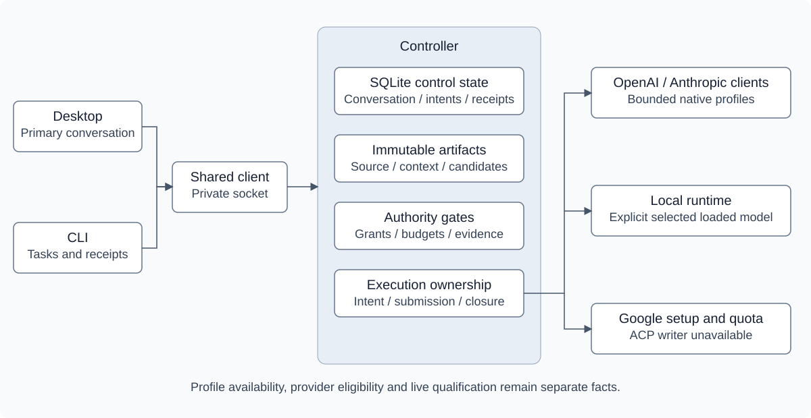
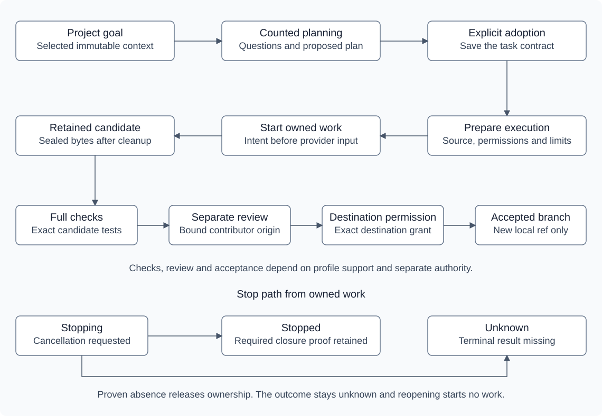

# Architecture

This page describes the current design. The reasoning behind each choice is in the [ADRs](adr/README.md).

## Components

| Component | Owns | Does not own |
|-----------|------|--------------|
| `apps/controller` | State, policy, routing, provider adapters, execution host, artifacts, evidence | Trust in model output as authority |
| `apps/desktop` | Electron main and preload, React renderer, native pickers, a narrow bridge to the client | Database access, provider launches, arbitrary shell or file APIs |
| `apps/cli` | Human commands, interactive terminal mode, JSON output, offline diagnostics | A second permission, acceptance or database write path |
| `packages/contracts` | Runtime schemas, state and reason vocabularies, fixture contracts | Electron, database or provider code |
| `packages/client` | Handshake, typed commands, reconnect and replay, bounded reads | Domain transitions, provider protocols |
| `packages/testkit` | Fake provider executables, synthetic repositories, injected clocks, fault fixtures | Any production inference route |

Provider adapters stay inside the controller until a second consumer needs them. One integration owner lands changes to contracts, migrations, the lockfile and entry points, so the packages never drift apart.



A fresh normal workspace has no seeded project or fixture route catalog. Its prepared native profiles and explicit Local connection use their real provider protocols. Developer demo and preview modes remain explicit. A failed native operation retains its own refusal or uncertainty; it grants no fallback authority.

## Chat thread

A thread is one conversation about one project. The first message creates the task record, and every later message belongs to it. The controller keeps the thread's base commit, the current provider and model, a permission policy, and one native session ID for each provider that has run on the thread.

A turn is one user message and the provider's response until it yields. A thread runs one turn at a time, and a turn has a thirty minute deadline. The turn is the unit of Stop and process cleanup. It ends as done, stopped or failed. A usage-limit refusal ends as failed, with the reset time on the failure when the provider reports one.

A message sent during a turn waits in the thread record, up to eight of them, and joins the conversation only when it starts. When the turn ends, the oldest one starts on the thread's current provider and model, so a handoff in between carries it along. Every stop writes one line in the thread naming its cause (Stop, Send now, the plan, a restart or the client), and the turn record keeps the cause as `stopCause`. A side question runs beside the turn and never queues ([ADR 0050](adr/0050-a-side-question-runs-beside-the-active-turn.md)). Stop ends the running turn and keeps the queue, paused: the thread record marks it `queuePaused`, and nothing in it starts by itself, after a restart too. Each message waits for Send now, which starts it at once while the rest stay paused, or Remove. A new message sent to a paused thread starts at once. The pause clears when the queue empties. Nothing goes back to the composer. `crewkite thread stop` prints how many messages are waiting. A usage limit on the newest turn holds the queue, since the next message would stop on the same limit. It starts again after the person continues on another provider or sends another message, or once Start at reset runs the stopped message again on the same family ([Continuity](continuity.md#start-at-reset)). A provider process that outlived its turn holds it until a later send or a restart finds the process gone. A restart or a reboot alone does not release it, because a process number can be reused by another program. Such a thread can stay held while that number is in use, and other threads still work. Queued messages survive a restart and start once the thread is free, including after a restart that failed the turn they waited behind. Any other failed turn holds the queue until the person retries or sends again. `ConfigureChatThread` with `dequeue` takes one back. The composer offers Challenge assumptions next to Review changes and Second opinion. It runs one read-only turn on a model picked for it, with a brief that asks for the assumptions behind the last answer and the evidence that would settle each one.

An adapter owns one native process or connection for one turn. Each implements `ChatAdapter` in `apps/controller/src/chat/adapter.ts`: `startTurn` returns a handle with `respondPermission`, `stop`, the process groups the controller has to prove absent, and a `result` promise. Adapters are the only code that knows a provider's protocol. [Provider routes](providers.md) names the transport of each.

```text
renderer ---- SendChatMessage ----> controller
                                      one turn at a time per thread
                                      scratch copy of the base commit
                                            |
                                            v
                                         adapter <----> provider client
                                            |
                                     AgentEvent stream
                                            |
                    event log <-------------+-------------> renderer
renderer ---- ResolveChatPermission ----> controller ----> adapter
```

Adapters emit the `AgentEvent` values defined in `packages/contracts/src/chat.ts`: turn start, text and thinking deltas with one completed event per item, tool start, output and completion, permission requested and resolved, context usage, turn stats, context compaction, provider notices and turn completion. Unknown client methods go to a trace file in the turn's work folder and never reach the thread. The controller validates each event, appends it to the event log under the task and forwards it to clients as `agent.event`. An event it cannot read becomes one provider notice per turn and never ends the turn. The renderer folds the stream into messages and cards and knows nothing provider-specific. A view that opens in the middle of a turn rebuilds it from the log. The controller also emits `chat.turn` and `chat.thread` when those records change, and `conversation.entry` for each stored message. `chat.catalog` marks the end of a model read, with the number of models it stored or the reason it failed, so an open picker reads the catalog again.

The first turn copies the committed files of the project's HEAD into a scratch directory under the controller home, and that commit becomes the thread's base. A link whose target stays inside the repository is copied as a link. Submodules, links that lead outside and paths that are not UTF-8 stay out of the copy, and the controller lists them. Every adapter runs with the copy as its working directory. Anthropic and Local turns get the instruction files at the copy's root in their system context, up to 64 KiB, because neither client loads them there. OpenAI and Google read their own. Every family also gets the project's notes with each turn. A new session reads them in its system context. A resumed session receives them in front of its message when they differ from the hash the controller saved with that session. A writing turn also gets the writing rules that are on in Settings, and the project's design brief when one is delivered. The notes take at most 16 KiB of the 64 KiB, the writing rules and the brief count in the same 64 KiB, and the instruction files get what is left, cut at a whole line. Changes compares the copy with the base commit and honors the base's ignore rules. The person's checkout is never written. Edits leave the copy only through branch acceptance under [ADR 0008](adr/0008-isolated-writers-local-branch-acceptance.md), from the Changes tab. Acceptance builds the branch on the thread's base whatever HEAD is now. Links and every entry the copy left out go into the branch as the base has them. The base then moves to the accepted commit. A ref at `refs/crewkite/threads/<task>` in the project repository points at the current base, so the base survives garbage collection after the person deletes an accepted branch. Writing it changes no working tree, HEAD or branch, and deleting the thread removes it. Discard puts one path of the copy back the way the base has it, remakes a base link the copy changed and refuses entries the copy never held. Changes reads in pages of up to 2,000 entries under one listing digest, and every changed file reaches a page, so Accept publishes any number of files and still only files the person could review. Accept refuses when the copy moved from the listing the tab read. A text file both sides hold shows its hunks with Accept and Discard each; Accept to branch then takes only its accepted hunks and leaves the others in the copy, and a comment on a hunk joins the thread as a queued message that quotes it. The [ADR 0027 amendment](adr/0027-page-large-data-without-project-size-ceilings.md#amendment-2026-10-31-the-changes-list-pages-and-accept-takes-hunks) records the rules. Pushing that branch and opening a pull request are separate clicks under [ADR 0037](adr/0037-push-and-pull-requests-from-the-changes-tab.md).

Every Accept is an attempt the thread records, and one attempt holds the thread at a time. Accept builds the commit first and checks it against the commit policy, so a refused message costs no check run. A saved design system with values in the changed files that go around it refuses the attempt next. With project checks on, Accept freezes the candidate tree, writes it into a copy of its own with its own prepared dependencies and runs the enabled checks there before it writes the branch. While they run, new messages wait, and Discard, Retry, handoff, plans and another Accept refuse. A check that fails or changes a file Accept would publish, a hunk decision, check setting or dependency that changed meanwhile, or a check whose process may still run refuses the attempt, and nothing publishes. A refusal names the files a check changed and keeps that copy until the next Accept. Cancel stops the checks and publishes nothing. A restart leaves an unfinished attempt unknown and removes its copy, and only a new Accept, which runs the checks again, writes the branch. A base that holds a link, a submodule or a path that is not UTF-8 cannot be written into that copy, so a checked Accept refuses there. With no check on, Accept publishes in the command.

The scratch copy has no installed dependencies, because it holds committed files only. `PrepareDependencies` copies the person's own installed tree into one copy: the thread's scratch, a lane's copy or an Accept candidate. It reads package.json, the lockfile and the workspace file, and it supports no dependencies, a single package with `package-lock.json`, a single package with a version 9 `pnpm-lock.yaml`, and a pnpm workspace whose packages all live inside the project. It compares each installed package with the version the lockfile resolved, so a range in package.json works. Files are copied as bytes with no link back to the person's tree, and every link inside the tree must stay inside it. The record keeps the manifest, lockfile and workspace digests, the Node runtime, the package manager, the platform, the tree digest and the byte count. A copy holds at most 2 GiB. Over that the preparation fails with the over-limit line and keeps nothing. Yarn Plug and Play, links or workspaces outside the project, a tracked `node_modules`, submodules and packages that build a native addon are refused with their reason. If a manifest, the lockfile, the workspace layout or the runtime changes, the record turns stale and shows "Dependencies need preparation." until the copy is prepared again. For the thread's own copy that is Prepare dependencies, offered wherever the line shows, or `crewkite thread prepare`. The copy can take minutes, so the command answers when it is done. It holds no desktop command lock, and the controller answers other commands on the same connection meanwhile. Preparing removes the copy's `node_modules` first, so the controller refuses it while a turn, a crew step, a plan, a process an earlier turn left behind, a check or an Accept may run in the thread, and refuses a second one for the same copy. The thread cannot be deleted while one of its copies is being prepared. An Accept whose copy was prepared again while its checks ran refuses to publish. Plan lanes and Accept prepare their own copies, and the checks after a writing turn or a merge prepare the thread's copy when it needs it. Nothing installs packages and nothing reaches the network. Node looks for modules in every ancestor `node_modules` and in `NODE_PATH`. A package found that way would pass a check here and fail on any other machine. So preparation refuses a copy with a `node_modules` in any ancestor directory, and the environment it hands out clears `NODE_PATH`. The copy is not hashed again on each check, so a tool that edits it in place is not detected until the next preparation.

Before a pull request merges, the controller can check the accepted branch against the pull request's base. It fetches that one branch from a remote the person configured, with their own git setup, into a ref under `refs/crewkite/fetched/` that goes once the check ends. It merges the accepted commit onto that base in a scratch repository that borrows the project's objects, so the checkout, the index and every branch stay as they are. A clean merge changes nothing. When text files conflict, the copy moves onto the fetched base with the merge in it, and each conflicting file keeps Git's markers with the thread's side, the common ancestor and the base side. One fixer turn gets those three sides and a fixed brief: keep both changes, keep the thread's intent, change no other file. In a crew that reviews, the turn runs as a fix step, so the checks and the review follow it. The thread record carries that waiting merge, so the Changes tab offers the accepted branch with an empty message, which the controller fills with the merge's own, and any Accept clears it. Accept to the same branch then commits the result under the commit policy. Under the squash and merge methods the commit's parents are the accepted commit and the base. Under rebase the thread's work becomes one commit on the base. Accept refuses while a marker the merge wrote is left. A binary file, a link, a submodule, a file deleted on one side, a merged file past 4 MiB and more than 16 conflicting files refuse with their paths, and the person merges in a local checkout. Nothing is pushed.

A permission request is an event in the thread. The adapter asks with the provider's own question and a list of options: allow once, allow for this thread, deny. The thread view shows it inline and `ResolveChatPermission` answers it. The controller accepts an answer only for a request that is open on the active turn, and only with an option that request offered. It then hands the answer to the adapter, which passes it through the provider's native approval channel. Model text cannot answer a request, which keeps [ADR 0002](adr/0002-authority-in-deterministic-code.md) intact. The thread's permission policy sets what an adapter may answer for itself: ask each time, allow edits or allow all. A new thread asks every time. An answer nobody asked the person for carries `answeredBy` (thread grant, policy, flight mode or read-only), and the thread shows it as one line under the tool card. A request carries the tool kind when the adapter knows it, so a client that asks before its tool starts still gets Allow for this thread recorded. [Crew and permissions](crew-and-permissions.md) has the matrices.

A failed turn keeps a failure record: the stage, a kind, one sentence saying what happened, the provider's own message and method when it has them, and the next action. The thread shows it as a system line. `protocol` is a kind for the record and is never the text the person reads.

`HandoffChatThread` moves a thread to another provider. The controller never asks the stopped model to summarize its own work, in line with [ADR 0007](adr/0007-recover-from-durable-facts.md). The next turn's first prompt is built from stored facts: the last 60 messages of the transcript, with user messages verbatim, the last three assistant answers in full and earlier answers cut to 600 characters, the changed files with their line counts, and the new message. The new provider reads the files itself in the same scratch copy. The earlier provider's session ID stays on the thread, so moving back resumes it when that provider allows.

### Subagents

A provider client can start subagents inside a turn, and they spend the same family's allowance. I show them so a gauge never moves with no visible cause. Each adapter reads its own client's signal and reports to one tracker in `apps/controller/src/chat/subagents.ts`, which sends `tool.subagents` events. Each event is the whole picture for one parent tool call: how many subagents run, how many finished, and up to 32 of them with their state, latest action and model when the client names one. The newest event replaces the one before it, so the fold in the renderer stays a plain replace.

The Anthropic client tags every subagent frame with the call that started it. I count those frames under that call and take the subagent's tool calls as its latest action. Its text never joins the reply. It finishes when the parent call's result arrives, except a background spawn, whose call returns at once. Its permission asks carry no parent and take the usual path. The OpenAI app-server reports agent items, and a subagent's own items arrive under its own thread ID. An item type the adapter has no reader for becomes a card titled with its type in words, and one whose type names an agent counts its subagents from whatever thread IDs and states it carries. A spawn that names no thread yet counts one stand-in, which gives way once the threads arrive. A subagent's command and file change keep their command, paths and delete mark, so its approval reads and is answered like a parent one, and its token use joins the turn's stats. The Google adapter counts a tool call that names a subagent and gives each other session to the newest running subagent that has none. That session's tool calls become the subagent's latest action, and its permission requests go through the parent's policy; a request from any other session is declined. A tool call with no readable ID becomes a card of its own. A subagent the client never reports finished is stopped when the turn ends.

Each crew role has an Allow subagents switch. The controller reads the switch of the role the turn runs as and passes the client's own control: `--disallowedTools Task,Agent` for Anthropic, `features.multi_agent` on the OpenAI launch, which lasts exactly one turn, and `invoke_subagent` in the Google session's disabled tools. A role the person never set, and a turn outside a crew, take the family default, which is on for OpenAI, Anthropic and Google. OpenAI started off until a live run could show its subagents following the turn's approval policy. The d3-rc4 live check showed that: OpenAI subagents ran and their commands followed the thread's policy, so OpenAI now defaults to on like the others and its switch carries no note.

The turn header shows a chip with the role, the family mark, the model and the effort, and a badge with a live count while subagents run. The spawn card lists each subagent with its latest action. Both read the pure view model in `apps/desktop/src/renderer/thread/subagent-view.ts`.

## Scratch copies

The first turn on a thread fills its scratch copy from the thread's base. When the checkout sits on that base and Git reports no change to a tracked file, a regular file whose size matches the committed copy is cloned from the checkout, on a volume that supports copy-on-write clones. The controller hashes each clone as a Git blob and compares it with the committed object ID, and a mismatch is replaced with the committed bytes. Every other file is read from Git in runs of at most 32 MiB, and a single file larger than a run streams straight into the copy. A copy has no file count cap. Before it writes, it checks free space on the disk that holds the CrewKite home: the base's size plus 1 GiB when it writes every byte, and 1 GiB when it may clone. When the volume refuses a clone, it checks the rest before it writes on, and again every 256 MiB. A refusal names what the copy needs and what is free, and removes the partial copy.

Changes, Discard and Accept compare by object ID and read only the changed files. A comparison reads at most 64 MiB of changed files for its patches. A changed file past that shows a "Not compared" note, and Accept still takes it.

## Plan slices

A plan from the orchestrator runs as the controller decides ([ADR 0045](adr/0045-the-orchestrator-proposes-and-the-controller-assigns.md) and its parallel amendment). The orchestrator proposes the plan and never picks which slice starts. Slices whose dependencies are done start together, each in its own scratch copy made from the thread's base and brought up to the thread's copy. At most one turn runs per provider family across all threads, so ready slices on one family run in plan order. Each slice runs the review chain with the same caps as a crew.

A finished slice replays onto the thread's copy in plan order. The comparison uses blob IDs and modes. A changed path is a conflict when the thread's copy holds neither what the slice started from nor the slice's own version. The slice then shows as Blocked with those paths, its other paths merge, and the orchestrator's model gets one fixer turn in the thread's copy with the conflicting versions quoted. A failed or stopped step stops the plan, and a slice can then run again from a fresh copy. In Balanced and Glide with project checks on, each builder or fixer turn of a slice runs them in the slice's own copy with its own prepared dependencies before anything of the slice merges. A failure goes to the slice's fixer, two fixes at most, and a slice that still fails stops the plan. Each merge that changes the thread's copy runs the checks there before the next slice merges, so a slice that passes alone and breaks the merged result stops the plan with that slice named and failed. The challenger runs after the last merge.

## Project checks

The controller finds check commands in `package.json` scripts, `pyproject.toml` tool tables and pytest dependencies, a `pytest.ini`, Makefile `test`, `lint` and `typecheck` targets, a `Cargo.toml` and a `go.mod`. Each one starts off. A command the person adds is accepted only as a program that runs in the scratch copy. Shells, wrappers such as `env`, inline code flags and paths outside the copy are refused.

A run needs the thread's permission for commands. The approval covers those commands and the script text behind them, so a changed script asks again. Checks run as local processes with the person's permissions, and nothing contains them. Balanced and Glide run the enabled checks after each writing turn of the crew, the builder's and each fix, after each writing turn of a plan slice in the slice's own copy, and after each merge of a slice into the thread's copy. The checks after a turn run one after another in the thread's copy with its prepared dependencies, ten minutes each and fifteen in all, and the design check follows when the project saved a design system. A plan's checks run the commands only, one plan event at a time per thread, with the same limits. The controller prepares a slice's copy itself, since it makes that copy fresh for each slice, and prepares the thread's copy before the gate after a writing turn and before the checks after a merge when it needs it. A preparation that fails, is refused or finds the copy's own files no longer match the project stops the chain or the plan with its line. A failure goes to the fixer, two fixes at most, once every process is proven gone. A check whose process may still run fails the checks after it without starting them. A stale dependency copy, a process that may still run, or checks, permissions or dependencies that changed while they ran stop the chain with no repair. Run tests runs the thread's test command on its own, whether its switch is on or off, in the thread's copy and with no model turn. It waits while a turn, a crew step, a plan or another check run is open, asks the same question unless the thread already allows that command, and writes one line with the command and its exit status. The full output goes to the artifact store, and the thread shows a redacted tail of the last 1,000 characters.

An approval covers what the question showed. The answer reads the copy again, and a command or script that changed in between runs nothing and asks again. A check that changes the files Accept would publish cannot pass, whatever its exit code. The run names the files and leaves them for review. Accept, Discard and the hunk commands refuse while a check runs in the copy or waits on its question. A check whose process CrewKite cannot confirm ended reads as unknown and holds the thread. The hold reads every check of the thread that has not ended, so no number of later checks lifts it, and Run tests refuses while it stands. If the controller stops between journaling a check's intent and recording its process group, nothing in CrewKite proves that process gone, and the hold would last forever. `ReleaseChatCheck` lets the person release it with an explicit confirmation and a note on what they checked. The same goes for a check left running at intent that nothing in this controller owns, which a failed journal write can leave behind. CrewKite proves nothing and signals nothing for it. The check's record fails with the note as its reason, the run reads failed and says the person released it, the thread gets one line and the queue moves on. A check still open in this controller, or one whose recorded group is still present, keeps the thread held. No release covers a provider process, so a thread it also holds stays held, and the release's line says so. The release also covers a design preview pass, which runs in the thread's own copy, and a project command started for the thread, which runs in a folder of its own. A deleted thread takes its settled checks with it: the records, their launch identities, receipts and artifacts. Each operation's own folder under the home goes with it. Before it refuses, a delete settles every unended check that a restart would settle, one whose recorded process group is gone, so a hold that has lifted never blocks the delete. A command prepared and never started has no process, so it goes too. A check still running refuses the delete until it ends. One that has not ended and that nothing runs keeps the thread and answers with the hold's sentence. A command that could not start leaves no process, so it fails and holds nothing. That covers a file the system will not run, a missing interpreter and an executable that changed after it was pinned. The controller drops the command's journal intent when the spawn fails, so a restart finds nothing to hold either.

## Project design system

A project can keep one design system, in one JSON file at a path the person picks, in the format [Proposed ADR 0055](adr/0055-a-project-design-system-is-one-file-in-the-w3c-tokens-format.md) describes. The controller records each saved version and its hash in SQLite. Saving writes that file in the person's working tree after they confirm the diff, and commits nothing. It refuses a path through a link and a file that changed on disk since the last save, so a save does not overwrite an edit made outside CrewKite. A read reports the file as current, changed, missing or invalid against the recorded hash. An import reads another source into a draft and saves nothing. A draft from a description asks the default crew's orchestrator model, or the model a new thread starts on, once. That turn only reads, belongs to no thread and runs in an empty folder, and its prompt names the project's style files by path. A restart removes the folders such turns left behind and signals nothing. Each value of the answer the format accepts becomes a token, a component or a rule, and the rest count as skipped. Nothing is saved. A retried command answers from its receipt and never asks a model twice. A missing provider, a usage limit or an unreadable answer refuses, and nothing retries or moves to credits. Settings has a Design system card that opens a full-window editor, where a save shows the diff against the version the edits started from.

Writing turns on every provider work from the saved version, never the file. A new provider session receives it as one brief with the writing rules, and each writing turn records the version it was given and the brief's size in bytes. Saving a new version or turning delivery off starts a new session on the next writing turn, so an old brief never stays in one. Every resumed writing turn receives the brief again: OpenAI in the developer instructions sent on resume, Local in the system prompt it rebuilds each turn, and Anthropic and Google in front of the message, beside the writing rules. An Anthropic or Google client can compact a long session and drop its first message, and the controller does not track when that happens. That costs the brief's bytes on each of those turns, and it leaves less room for what a resumed session missed, so a session that fell behind gives way to a new one sooner. The brief counts in the 64 KiB context limit, and a turn it cannot fit is refused.

The design check reads the thread's changed CSS, TSX and JSX files against the saved version, with the copy's other style files as context, so a value declared in one file and read in another is reported where it is read. Each value that goes around the tokens becomes a finding with its file, line, rule and the nearest token: a raw color, a spacing or radius off the scale, a font family no token names, or a shadow written by hand. A changed file that is too large, nested too deep or too costly to read is named and fails the check, so a file the check skipped never reads as clean. The check keeps one run with the thread's checks. It runs in the gate after a writing turn and at every Accept, and the thread inspector's Design tab runs it on demand. That tab lists the findings with three actions: send them to the fixer, where they ride on the crew's next fix step, allow one once with a reason, or open the editor to add the value as a token, which settles the finding once a saved version holds it.

A project with a saved design system can also declare a preview: the command that serves it, a loopback address and up to six named views. Before each review in a crew, the controller starts that command in the thread's copy, shoots each view and hands the reviewer the images with the brief. The command follows the rules for a check command a person adds. It starts a server from scripts a model may have just edited, so it runs only once the person allowed it, in every flight mode, Glide included. The question is the one the project checks use, and it shows the checks and the preview as one set, so one allow for the thread covers both. That allow pins the commands and the scripts they run, and a changed script asks once more. A denied preview skips its pass with one line and leaves the checks their own question. The address must be free before the command starts, so the pass never shoots another server that already listens there, and two passes never share one address. A page that redirects off the address is not shot. Stop and quit end the preview process, and the controller waits for it before it closes. A preview that fails, or that changes files Accept would publish, is one failed step with the changed paths, and the review runs without images. Images go into the thread's files only when the review takes them.

## Recipes

A recipe keeps the setup of a plan run so it can run again: the crew, the run settings, the checks and, for a schedule, its trigger, budget and work. It is one JSON file in the project, in a folder the person picks, as [Proposed ADR 0057](adr/0057-a-recipe-is-one-file-and-only-a-saved-version-runs.md) describes. The picker offers `.crewkite/recipes`, and a first save with no folder picked records the folder it saved into. The list shows the recorded recipes first and then every other `*.json` file directly in that folder, up to 64 in all. It follows no link and reads a file over 1 MiB as invalid. A save refuses a path that differs from another recipe's only in letter case, since a case-insensitive disk holds them as one file. On a case-sensitive disk the list shows such a file as its own. The controller records each saved version and its hash in SQLite. The hash is taken over the parsed recipe, so key order, spacing and filled defaults do not move it. A read compares each file with its record and reports it as current, changed on disk, missing, invalid with its first problem and line, or never saved here.

Only a recorded version runs. A file edited on disk, or one a teammate committed, starts nothing until the person reviews it and saves it here. A save writes the file in the working tree after the person confirmed the diff, and commits nothing. It refuses a stale version, a path through a link, a path another recipe holds, a file CrewKite never saved that holds something else and a file edited since the last save, so it never writes over someone's edit. Forgetting a recipe drops its record, its versions and its schedule. The file, the runs and the results stay. While a run of the recipe is going, forgetting it refuses.

Each check command follows the rule for a check a person adds to a thread, and a save refuses one that breaks it with the thread's own sentence. A recipe travels with the project, so a check command cannot name an absolute path either. Saving a recipe with a trigger approves its checks for scheduled runs ([Proposed ADR 0058](adr/0058-a-schedule-cannot-be-saved-without-a-budget.md)). The confirmation shows what each command resolves to and the digest a thread pins it by, both read from the project's committed HEAD, because that is what a run's copy starts from. The controller writes the few files a check reads from HEAD into a private folder under its home, reads them the way a thread does and removes the folder. A file over 1 MiB is only checked for being there, so it becomes an empty file of the same size and nothing large is copied. Nothing in the project runs. The save works both out again and refuses when the person never opened the review, when a command or a digest differs from what they saw, or when a check resolves to nothing. A check resolves only when its digest covers project content: it is a check the thread detects, or it names a package.json script or a file whose content the digest takes in. A folder argument such as `pytest tests/` leaves the digest covering only the command's words, and the digest never covers a program path such as `./gradlew`. A later commit could then change what runs with nobody asked, so neither resolves. A manual recipe approves nothing, so it saves with such a check.

Saving a finished plan thread as a recipe drafts the file from what the thread holds. `DraftRecipe` reads the thread and saves nothing. The crew, the permission policy, the handoff settings and the enabled checks come from the thread as it stands. The most slices is the number the plan had. A Manual thread drafts as Balanced, since Manual runs no plan, and the draft says so in its list of defaults. A thread with no finished plan, or a crew without an orchestrator and a builder, refuses.

`RunRecipe` does what a person does by hand, in one transaction, and it runs only the saved version. It refuses in a fixed order before it writes anything: a recipe that is gone, a `versionHash` that is not the current one, a file that is not the recorded version, a crew member that is not ready (named by provider and role), a check command the thread would refuse, and a recipe whose checks and the project's do not fit in the thread's 16. The checks are counted from the files at the committed HEAD. Then whatever would refuse the orchestrator's first turn refuses the run: no client for its provider, terms not acknowledged, or an allowance used up with credit spending off and nowhere to move. A refused run leaves no thread, no row, no copy and no ref. A run then creates the thread in the recipe's project. Its first line is `Run of {name}, version {n}.`, and then it makes the copy. It sets the crew, the flight mode and the permission policy, then the handoff settings, since entering Glide turns automatic handoff on, then reads the checks the copy declares, then takes each recipe check by its normalized command as the thread holds it at that moment: one already on stays, one that is off is switched on, and any other is added as a command the person wrote. Two commands that read the same once normalized turn one check on. The request then goes in as the thread's first message through the normal send. A refusal or a failure after the copy exists removes the copy and its ref the way a delete does, since a rolled back transaction leaves the disk as it was. The run row records the recipe, the version and its hash, the origin, and one allowance reading per metered provider the crew names, read from the catalog as it stands with no provider call. A reading the catalog has no value for is unknown.

Report runs are off in this release. The recipe list read carries the two controller options, `checklistWork` and `reportRuns`, so the editor shows Report only and A checklist file as not available while each is off, keeps Run off for a report recipe, and offers them again once it is on. Running a report recipe is refused with a sentence that says so, by hand and from a loop, a report recipe with a trigger is refused at the save, and the rest of this paragraph describes what waits behind that switch. A report recipe runs a plan whose slices only read. A thread that a report recipe's run started is a report thread for its whole life, told from the run type the run row keeps, whatever the run's state, so forgetting the recipe changes nothing. Every orchestrator turn on it plans with the report run's brief, whichever message it answers, every plan it proposes is a report plan, whoever sent the message, and a plan card stored without that mark gets it when it runs. Nothing about a report run is read from the words of a message. The orchestrator's brief tells it to always reply with a plan whose every slice only reads, and a slice ends with its findings, one per line, each with the file and line it rests on. A reply with no plan and a plan with a slice that writes both go back once, and then stop the plan: `A report run only reads. The plan has a slice that writes.` is the sentence for a writing slice while the run is going, and `This thread reports and only reads. Start a new thread to change files.` once it has ended. Each slice runs as a read-only turn in its own copy, with no review, fix, check or merge. When the last slice ends, the challenger takes one turn on every slice's findings and says for each whether it stands and why, and then the orchestrator takes one turn and writes one message with the findings that stand and a last line `Findings: {n}`. The plan's record names the message that asks for the report, and the report turn is the turn that answers it, on whichever provider it runs, and a continuation of the report answers a message of its own, which the record names from then on. The two briefs are cut to fit one message in UTF-8 bytes, each part at a code point, and say where they were cut. The count is the last line of the report that is not empty, and it counts only when it reads `Findings: {n}` with n from 0 to 9999, a period after it allowed and bold marks around it only when they match. A zero after a line that is a finding, one whose first word after a list marker is a file and line, is stored as no count with `Report finished. Its count says no finding stands, and it lists findings.`, since the report contradicts itself and text a slice read could have steered it. Every turn of a report thread that is not a writer starts read only with no grants, whatever the thread allows, and no writer's turn starts there at all: a message to the builder or the fixer gets `This thread reports and only reads. Start a new thread to change files.` How that is enforced depends on the provider. The OpenAI client runs it under the restricted-read profile of [ADR 0048](adr/0048-restricted-reads-through-a-named-permission-profile.md), or on the plain read-only sandbox when the build has no profiles. The Anthropic client starts with the Read, Grep and Glob tools only. Google refuses every edit and command call, and Local leaves out the tools that change files. ADR 0048 applies to the first of these only. Both closing turns pass the same turn admission as any other turn, so a schedule's limit applies to them and the schedule's step line names the second `The report`. A limit on either turn with a provider to move to reruns the same step there with the same brief, and the plan waits for the rerun. At the end the controller compares the thread's copy with its base. A copy that changed ends the plan failed with `Report stopped: the run changed files, and a report only reads.`, and a copy it cannot compare ends it failed with `Report stopped: the run's copy could not be compared, and a report only reads.` Otherwise the plan finishes with one line, `Report finished: {n} findings stand.`, `Report finished: 1 finding stands.` or `Report finished: no finding stands.`, or `Report finished. It did not state how many findings stand.` when the report has no count, and the run reads reported with that count. A slice that fails, a limit with nowhere to move on and a stop by the person end the plan as they end a change plan, once, and no closing turn runs after a failure, and a report that cannot start says why in the thread before the plan's stop line. Retry on a failed slice runs the rest of the plan as a report, closing turns included, and Retry, Regenerate or a continuation of the report, Continue on its limit card and the start at reset run the report again, with the copy check. Each ends with its own line and notice, and the run's row keeps the state it ended in. A report recipe takes a fixed request. The contract refuses one whose work is a checklist, since a checklist run is asked to tick its item and a report writes nothing.

A manual run approves no check command, so the thread asks the way it does for any check. A scheduled start passes what the person approved when they armed the schedule. The thread's check approval is set only when every check resolves, in the new copy, to the digest that was approved. A script that changed since asks. The slice limit rides on the run: the orchestrator's brief states the recipe's limit in place of 8, and a plan with more slices goes back once with the schema's own words, the way a plan over 8 does.

A run's state follows its thread. The chat service and the plan runner send one event for each fact they decide: a plan proposed, started or ended, each step and each gate, a question for the person and its answer, an Accept, a discard and a delete. Most go out inside the transaction that writes their fact, and the run tracker moves the run's row in that same transaction, so a count of rows never disagrees with a thread. Two go out right after their commit: a permission request, once the client did not answer it on its own, and the end of an orchestrator turn that wrote no plan, once nothing moved the work on. A listener that fails leaves nothing written. A run waits on the person, and reads asked, while any question of its thread is open: a plan waiting for Run plan, a permission request or the checks question. A turn that ends with its question still open closes that question, and the answer moves the run on. A paused plan waits on the person too. While the plan is stopped with slices left, the run reads asked through any question that comes and goes, until the person runs the rest, accepts, empties the copy or deletes the thread. A finished plan makes the run ready with the number of files its copy changed, or no-change when it changed none, and its findings are the sum of what each slice's first review stated. A failed or stopped plan ends the run with the thread's line as its reason. Accept settles any run that has not ended as accepted, and a discard that leaves the copy with no change settles a run that waits or is ready as discarded. A run whose plan is still at work stays running through such a discard, since its next step writes again. Deleting the thread stops a run that was going or asked and discards one that was ready. The first move into ready or an end records the time and one allowance reading per metered provider, read the way the start was. Later moves keep them, so the readings never cover the wait for Accept. A run is its first plan: a ready run stays ready through a later plan on its thread, and a run that has ended never moves and reads nothing more from its thread. The tracker hears what startup recovery stops. Once recovery is done, it reads each run that is going, asked or ready from its thread again, one at a time, and a row it cannot read is logged and left. A thread that is gone settles the run. A plan waiting for Run plan means asked. A newest turn that recovery failed means failed. A finished plan means ready or no-change. A stopped plan means asked while its copy holds changes and stopped when it holds none, so a restart never records a pause as stopped. An orchestrator turn that ended without a plan ends the run the way the turn ended.

## Schedules

The desktop and the CLI call a schedule a loop. [Terms](terms.md) maps the words a person reads to the names used here.

A recipe whose saved version has a trigger has a schedule, as [Proposed ADR 0058](adr/0058-a-schedule-cannot-be-saved-without-a-budget.md) describes. Saving that version arms it in the save's transaction, with what the person approved for its checks. Saving again arms the new version with its new approval, keeps the state and the counts, and lifts a pause the recipe file caused. A pause at the waiting limit follows the limit just saved: it lifts when the count is under it and holds when it is not, and an active schedule at or over the new limit pauses. A pause the person made and a stopped schedule stay as they are. An interval's grid starts when the schedule was armed, its first start is one step later, and the grid moves only when the trigger changes. Saving a manual version drops the schedule, and so does forgetting the recipe. A save over a schedule row that does not read arms a fresh schedule in its place.

A schedule with a next start ahead has one timer. A start that came due with no client attached has none and goes through the rule when one attaches. A reset schedule with no next start has a timer that only reads the usage again, and none while no client is attached. For a schedule with a next start it waits for that start, and the controller's clock is the only clock it reads. When it fires, nothing happens unless the schedule is still active with that exact next start and a client is attached. A timer that wakes before its start, because the wait was longer than a timer can hold, reads nothing else and is armed again for the rest of the wait. A run starts in the same transaction that moves the next start, so a timer that fires twice, or late, starts nothing a second time. A late timer keeps the grid.

The start rule decides each start in a fixed order. A recipe file that is not the armed version pauses the schedule, whether it changed, went missing or no longer reads as a recipe. The file is only hashed and compared with the saved version, the way `RunRecipe` compares it, so an edit on disk never arms or changes anything. Then two dry runs in a row or the run limit stop the schedule, and the waiting limit pauses it. A run of the recipe that is still going passes the start over, even behind a newer run that ended, and so does a crew member who is not ready, named by provider. A checklist that cannot be read pauses the schedule, and one with nothing left unchecked stops it. Only then does the scheduler ask for one usage read per metered provider the crew names, through the path start at reset already uses, and read the catalog. A read already running for that provider is the one it waits for. Each crew member reads the window that limits its own model, with the time that window was observed. A member with no reading, a reading 15 minutes old or older, and one above its limit each pass the start over. CrewKite never estimates a reading. A save that lands while the usage is read passes that start over too, since the work and the readings were read for a version that no longer runs. Otherwise the run starts through the function `RunRecipe` uses, with the schedule as its origin and the approved checks. A start that function refuses for a crew member who is not ready passes over, and one it refuses for a file that is not the armed version pauses as above. Any other refusal pauses the schedule with the refusal's own sentence, and Resume lifts it. A pause, a stop or a passed over start leaves one note on the schedule, and the line a person reads comes from `planScheduleLine`. After a start the note is empty unless the start has something to say: the missed starts it made up for, a stop, or a reset time no reading reports. A checklist start whose items an earlier run still holds keeps the note it had.

After a start or a passed over start, an interval waits for its next grid point and a once schedule stops, with the passed over start's reason when it had one. A reset trigger starts only at a reset a reading reported. A start there that is passed over for want of a reading tries again 15 minutes later. Any other start there, or one passed over for another reason, waits for the next reset a reading reports, and never one sooner than 15 minutes after the last run started: a reading can report the reset just used a moment late, and that must not start a second run. While no reset time is known the schedule has no next start, and its note says its provider has not reported when its allowance resets. Its timer then reads that provider's usage again every 15 minutes while a client is attached, only to look for a reset time, and never starts a run. The reset it finds becomes the next start. Whatever finds a next start, the look, a save, Resume or restart, clears a note that said the schedule waited for a reading or a reset time.

The counts follow the runs. A start counts toward the run limit at once, and the schedule stops at the limit while its last run keeps going. When a run the schedule started first ends, a run that changed nothing and found nothing, or a report that kept no finding, adds one to the dry count. A failed or stopped run leaves it, and any other end sets it to zero, a report with no count included. A run started by hand never moves it. The waiting count is the recipe's runs that are asked or ready, read again whenever one of them moves. Reaching the limit pauses the schedule, and that pause lifts on its own when an Accept, a discard or a delete brings the count under it, with the next start after that moment. The run tracker moves the run's row and the schedule's row in one transaction. A timer or a post that follows waits for that commit, and a pause or a stop posts once, when the change that made it is committed.

The person can pause any schedule that is not stopped, whatever paused it before, and only Resume lifts a pause the person made. Resume also lifts a pause an unreadable checklist or a refused start caused, and restart arms a stopped schedule with its counts at zero. Resume refuses a pause at the waiting limit, which lifts on its own, and any pause the file caused, which a save lifts, even once the file reads as the saved version again. Resume and restart both refuse while the file is not the armed version, and both refuse a once schedule whose time has passed and change nothing, since it would start at once. The person saves the recipe with a new time. `ReadSchedules` lists every schedule, or one project's, with the recipe's name, path and trigger, up to 200, and says whether each last run's thread is still there. A schedule row that does not read is left out of every pass over the rows, and each way it fails is logged once. Pause, Resume and restart on it refuse with a sentence, and a save arms a fresh schedule over it.

Schedules run only while CrewKite is open, and open means a client is attached: the desktop or a CLI session. A controller can outlive the app after a crash, so the server tells the scheduler how many clients it has, and a schedule that fails to wake never refuses a client. A start that comes due with none starts nothing and arms nothing. At startup, once recovery and the run tracker are done, and again when the first client attaches after a time with none, a schedule whose next start is still ahead gets its timer, and a reset schedule with no reset time known looks for one while a client is attached. One whose starts came due meanwhile makes one catch-up start through the same rule while a client is attached, and the others are logged as one note: `Skipped {n} runs while CrewKite was closed.` When the catch-up start is passed over too, its own note takes that place. A single missed start is the catch-up and logs nothing. A once schedule whose time passed while CrewKite was closed makes its one start then. A run that was going when CrewKite closed is recovered by its thread, and the schedule reads it as recovered.

Before every plan step and crew step on the thread of a run a schedule started, the provider the step runs on is read by the same rule, after any handoff or credit move picked it. That holds whatever the run's state and whichever plan the step belongs to: the plan, each slice's build, review, fix and merge fix, the challenge and the report, also a slice run again from the plan card after the run failed. A slice step is known by its slice. The report is the turn that answers the message the plan card names, on whichever provider it runs. The challenge is the challenger's turn at the crew's challenge step. The plan is the orchestrator's turn that answers the run's own request, or a message that opens with the line the plan's retry sends. The stored records cannot tell that retry from the same words sent by the person, so such a message is checked, which is the safe side. Any other turn the person sends, such as a message, a side question or a turn sent straight to a crew role, is not checked. A reading the rule cannot use is read once more for that turn, through the same refresh, and judged again. A read already running for that provider is the one it waits for. A read the reader refuses as too soon after its last attempt, 60 seconds for Anthropic and 90 seconds for OpenAI and Google, reads nothing new, so a reading still too old ends the step with `CrewKite has no current allowance reading for {provider}.` A step above the limit, with no current reading, or on a provider the budget sets no limit for never reaches the provider. It ends the way a usage limit ends a turn, so it stops, hands off or posts the way a limit makes it. Its line names the step, `Slice 2 did not start. Anthropic is at 86% used. The limit for this loop is 80%.`, and the plan's or the crew's stop line, the run's reason and the webhook's text all carry it. A handoff that follows gives the schedule's limit as its reason, in the thread, `Continued on OpenAI from Anthropic. Reason: the loop's limit for Anthropic.`, and in the packet the next provider reads. A report that moves to another provider is still the report, and ends the plan once. The provider's own limit line is written only for a turn the provider received. A handoff or a credit move never picks a provider the rule would refuse. Local is never checked, and a run started by hand applies no budget.

A scheduled run never accepts, pushes, merges or opens a pull request. It stops at ready for Accept and waits for the person. A schedule never turns on credit spending and never assigns a connection. When a schedule pauses or stops on its own, the webhook gets one event of kind paused or stopped, with the recipe's name and the schedule's line. A pause the person made, a pause a save made and a passed over start post nothing, except a once schedule's only start, whose stop posts.

Checklist work is off in this release. Saving a loop that names a checklist is refused with a sentence that says so, a loop armed before that starts no checklist work, since the run refuses its item with the same sentence and the loop pauses, and the rest of this paragraph describes the reader that waits behind that switch. It reads the file line by line and does not follow every rule of the markup, so it can take a line a person would not see as an open item. I will not let a run nobody watches do that. It comes on once the file is read with a full parser. A checklist schedule takes its work from a markdown file in the project. Each run reads that file from the committed HEAD, the same base the run's copy starts from, so the item it is given is in its copy to tick. The project's folder has to be its repository's own top level, so a folder inside another repository never reads that repository's file. An item is a task list line (`- [ ]`, `* [ ]`, `+ [ ]`, or a numbered `1. [ ]` or `1) [ ]`) at any indent. A line inside a fenced code block is no item, even when the fence opens on a list item's own line, and neither is a line inside an HTML comment. A comment that opens and closes on one line is dropped from it wherever it stands, so an item keeps its text around a note. A comment left open on a line cuts that line where it opens. When only list or quote markers stand before it, it also hides every line up to the one that closes it. After other text it hides nothing more, since the next list item ends the paragraph. A comment marker inside a code span is text. The run takes the first unchecked item whose text no other run of the recipe holds, and an item an earlier run still holds is passed over. Format characters such as zero-width spaces and bidi controls are removed from the text, control characters become spaces, and an item with nothing left is skipped. The item text is data: it goes into a fixed request and nothing in it is read as a setting, path or command. The run's change is expected to tick the item, and nothing checks that it did. A file that is missing, a link, over 256 KiB, not UTF-8, or that leaves a fence or a comment open at its end pauses the schedule, since it may hide items, and a file with no unchecked item stops it.

## Results

The controller keeps one record per step of each plan attempt in the `slice_results` table, as [Proposed ADR 0059](adr/0059-results-stay-on-the-device.md) describes. A step is a slice's build, review, fix, merge or resolve, or the plan's challenge or closing report. A record belongs to the turn that anchors the attempt and to its step: the slice's builder turn for a slice step, the orchestrator's turn for a plan step. So a retried slice and a second plan on the same thread get records of their own, and a review that runs three rounds stays one record whose time adds up. Every plan thread gets records. A record names the recipe, its version hash and the run only while that run has not ended, since a run is its thread's first plan. A later plan on the same thread records no recipe.

The recorder hears the same events as the run tracker and writes in the same transaction, inside a savepoint of its own, so a failure undoes only its own writes. When a step opens, its record takes the role, provider, model and effort of its first turn. When it first ends, it takes the writing rules and the design system that turn received. A slice step's first check is the first gate on its slice after the step first ended. A step of the whole plan has no slice of its own to check and keeps none. A build or a fix takes the first review that ended done after it: clean with zero findings, findings with more, unknown when the review stated no count. A review that failed or was stopped counts as no review. A build counts every fix round of its slice that ended, whatever the outcome. A value the controller did not see stays unknown or null, and nothing fills it in later.

The final state is the one value that moves. It reads unknown until the plan ends, then waiting when the thread's copy holds changes and none when nothing is left to decide, as with a report or a plan that changed nothing. A paused plan has not ended, so its records stay unknown. Accept moves waiting or unknown to accepted. A discard moves them to discarded only once the copy holds no change, and a discard of part of a change moves nothing. While the plan is still at work an emptied copy also moves the unknown records of the slices the plan shows done, and the records of slices still at work wait for its end. Deleting the thread moves them to discarded. After that a final value never moves.

Allowance used is what one usage window lost while the step's turns ran, read from the usage journal analytics reads, with no provider call and no catalog read. When a step turn starts, the recorder keeps the tightest window's newest reading from at most 15 minutes before. When the turn ends, it waits for the first reading of the same window ID observed at or after the end, and checks for it each time it hears an event and before each read. It gives the turn up when that first reading comes more than 15 minutes after the end, or never comes. The turn stands when both readings name the same reset time, the share left did not rise, the turn ran on no assigned connection, and no other chat turn on that provider, in any project, side questions and the step's own other rounds included, started before the closing reading without having ended by the opening one. Two readings with no reset time cannot rule out a reset, so they never stand. The value is what the readings moved while no other chat turn ran on that provider inside CrewKite. A task run and a design preview's own turn write no chat turn row, and use of the same account outside CrewKite leaves none, so the value can include any of them. A step can have no more rounds once its build ends, its slice merges or its plan ends. Then its record gets the sum and the window's ID, once, if every turn stood on that one window of one provider. One turn without a standing pair leaves the step at null for good. Local is never measured. The waiting turns live in memory, so a restart gives them up. A deleted thread's turns can no longer be checked, so a turn whose opening reading came before the last delete, or before the recorder started, never stands. Most steps still hold null, because a reading has to come soon after each turn. An index on each turn's provider and end, from migration 027, lets the check read only the turns that ended after the opening reading and the turns still open.

A step whose turn startup recovery failed never heard its end, a report included. Once recovery is done, the controller ends it from the turn's row, as failed, at the turn's end time. That time is the restart, so the duration stays null. A step ended this way is never ended again. A turn row the pass cannot read is named in one line of the log, its ID and the error's first line, and the next start reads it again.

`task_id` and `recipe_id` hold no foreign key, so a record outlives its thread and its recipe. A forgotten recipe's records stay and read with no name. `ReadResults` counts per recipe and per role and model, as the contract defines each figure. A role's row counts the slices that role ran a step on, so a reviewer's row reads the slices it reviewed and how many passed their first review. A slice counts as reviewed only when its first review gave a verdict, and the mean of fix rounds takes only builds whose plan has ended. A recipe's run count is every run it started, also one that ended before any step. Allowance sums stay per provider and window ID, most steps first, at most 24 per recipe. A row that does not parse is left out of a read and of a page. `ExportResults` pages through the records or the runs, newest first, at most 500 records or 250 runs a page. Both are reads and keep no receipt. Nothing is uploaded. A record leaves the device only in a file the person saves.

## GitHub writes

Every write CrewKite makes to a GitHub remote is a record in the `remote_effects` table: a push, a pull request opened, updated, marked ready or turned back into a draft, a reply to a review comment, a rerun and a merge. A write starts as a proposal whose preview shows the exact git or gh command, and nothing runs until the person confirms it. Push in the Changes tab confirms with its own question. Open pull request proposes and waits for the person to confirm the preview. The controller writes the record as sent the moment before the process starts, through the process owner, and keeps the process group beside it. The write ends applied with what the remote made, refused with the remote's own reason, or unknown when CrewKite cannot trust the result. One write of each kind is in flight per thread, and the thread cannot be deleted under one. A second Open pull request with another title or body cancels the waiting proposal and proposes the new one in the same transaction.

One function reads what a project remote is. An https remote names its host as written. An ssh remote names a name the person's ssh configuration may map elsewhere, so `ssh -G` resolves it first, reading the configuration and connecting to nothing, and GitHub's `ssh.github.com` on port 443 reads as github.com. A remote is a GitHub repository when its real host is github.com or the host `GH_HOST` names and its path is an owner and a name. An ssh name the configuration does not resolve is never guessed, and gh is never asked about it. Push is plain git with a lease and works for any remote git can reach. A push to a GitHub repository goes through the write journal. A push to any other remote, a path, `file://`, `git://`, http or another host, runs `git push` directly and is recorded on the thread. Either way the lease names what this thread last pushed to that branch of that remote: the newest applied push in the journal, which a reconcile or a settle keeps current, or the thread's record for a remote that is no GitHub repository. Pull requests, CI, merge readiness, review comments, re-runs and deploys need a GitHub repository, and for any other remote they say so in one line and run nothing. git and gh get the person's sign-in, ssh agent, GitHub host and token, and proxy variables from one list, and no other variable the controller holds.

Before a write to a pull request or a run is sent, a read checks that its head is still the one the person saw. A merge also reads branch protection, the branch rules and the head's check runs and statuses. It refuses while a required check is not green, the head moved or GitHub's merge state blocks it. A merge proposal makes the same reads, after it merges the head onto the freshly fetched base outside any checkout, and refuses on a conflict with the files that conflict. The merge call names the head sha, so GitHub refuses any other head, and nothing asks for an administrator bypass. Pull request text and replies follow the repository policy's attribution rule.

An unknown write is never sent again. Reconcile reads the remote: the branch tip at the push URL, an open pull request at the pushed head or one opened after the confirmation that is still open or was merged, the whole reply from the person's account, a newer run attempt, or the merge at the head it named. A read that finds nothing settles the write as refused only once its process is proven gone. Some writes no read can settle: GitHub stays out of reach, or the controller crashed between journaling the write and starting its process. Once a reconcile in the running controller has tried and failed, `SettleRemoteEffect` takes the person's word after they checked GitHub: done, which records the write as applied, or not sent, which records it as refused. The record keeps who settled it, when and their note, and no observation. That frees the write's kind and the thread delete. It reads and sends nothing. Startup marks a write that was being sent as unknown. It checks the group that write recorded and never signals it, since the number may belong to another process by then. The thread hears each change as a `remote-effect.updated` event. `ReadReviewComments` reads a pull request's newest review comments grouped by file, bound to the pull request and its head. `ReadMergeReadiness` makes the merge's own reads for the thread's pull request at the head the thread last pushed, before anyone clicks Merge: each required check by name and where it stands on that head, at most 100, and GitHub's merge state, which covers required reviews. `ReadRemoteEffectPreview` reads a write's record and its preview from the journal, so a proposal a restart left waiting can still be read and confirmed. Neither sends anything or proposes again.

## Task conversation

The structured planning turn described in this section is retired. It sent the whole history to a read-only session as one prompt with an output schema and kept only a final answer that matched the schema. The [chat thread](#chat-thread) replaces it, and [ADR 0036](adr/0036-the-chat-thread-is-the-product-center.md) records why. The tables it wrote stay in the schema because migrations only append. The rest of this section records how it worked.


The task's primary conversation retains messages, queued guidance, questions, answers and proposed plans with their run and attempt bindings. A planning turn needs explicit consent, the supported primary profile and finite limits. The current selection permits Lead or Orchestrator through `openai-file-v1`, with a separate existing-credit choice. Requested model and effort remain distinct from observed effective settings. Planning consumes the task's budget; reading history, reconnecting and reopening admit no turn.

A completed planning turn can retain its bounded model catalog only after the reply is accepted and every owned phase is quiescent. The immutable artifact binds the task, attempt, supported profile and exact client identity. Its public projection reports last-observed choices and time, with no local path or account identifier. Reading the catalog admits no provider work. A changed client or invalid artifact makes the choices stale or unavailable.

Saving an exact advertised model and effort requires the existing quiescent configuration boundary. A material change records the observation reference and creates a linked future planning run without launching a provider or resetting the task's allowance. It returns the task contract to provisional, so execution preparation requires a fresh valid plan adoption. The next admitted turn rechecks the current advertised pair, account and credit policy, then requires exact model and effort acknowledgement before its prompt. Failure retains the request and leaves effective settings unknown. There is no fallback or automatic refresh. Without a saved request, the supported profile default remains available for the first turn.

The future execution policy control supplies a revision-bound preparation draft. The host checks its task and planning configuration before opening the real preparation form. Authority changes clear unsaved sharing and grant confirmations. Explicit preparation freezes the supported policy; opening or closing a draft grants nothing. Existing prepared and running work keep their frozen policy. Planning remains read-only and tool-free.

Adopting a plan binds its exact proposal ID and hash to the task contract. It grants no execution authority. Execution still needs its own prepared source, policy, permissions and Start. Guidance received during active work is retained for a later explicitly admitted planning turn. Model text cannot approve an effect, raise a limit or accept a result. The renderer projects current send and adoption availability from controller reads and keeps uncertain command receipts for exact retry. Provider setup commands keep none, because a second send with a new key is safe ([ADR 0049](adr/0049-provider-setup-sends-again-without-receipt-replay.md)).

Selected context is immutable input data. The controller captures committed source files or folders at the chosen base, and explicitly selected project-local logs from current disk bytes. It accepts up to four selections, 32 files, 8 KiB per file and 32 KiB for the complete encoded bundle. Links, unsupported text and excluded credential paths refuse. The artifact records the exact bytes, modes and hashes. The desktop's native picker keeps filesystem selection in main; its renderer validates the retained artifact for a content preview before the separate send decision. Capture retry resends the original command without reopening the picker; a committed result returns the same artifact. Conversation inputs reference those artifacts by ID and hash. Context supplies no filesystem, execution or approval authority. The composer shows only profile-supported controls. A context byte measurement cannot establish a provider token count or quota balance.

## Combined runs

A combined run freezes one parent and two child tasks from the same project and committed base. Each child owns one distinct existing text file and works in independent scratch. Preparation binds their task contracts, source, writer profiles, policy, selected tests and reviewer. The initial workflow uses Quick quality with one Keep it simple review under guided or balanced authority. Child work cannot be amended, transferred or accepted independently while that membership owns it.

The parent reserves seven dispatches: a baseline check, two writers, two ordered replay checks, a full final check and one fresh review. It needs at least seven attempts and two concurrent slots. Its minute allowance covers both writer maxima, the reviewer maximum, four one-minute checks and the explicitly selected private integration allowance. Omitting that selection retains the original one-minute allowance. Dispatches charge one shared ledger; child task limits remain additional gates. Earlier planning remains charged to its task. Missing closure keeps the reserved allowance charged. No stage receives an automatic retry or a larger budget.

The clean baseline must pass before either child can start. Assembly requires two substantive, in-scope candidates. It applies their exact deltas in order and checks each cumulative result before advancing a private integration ref with compare-and-swap. A durable operation journal owns the finite Git processes. Each Git operation has at most sixty seconds within the frozen aggregate integration allowance; ref reconciliation uses that same allowance. Active or unknown integration retains its full reservation. Completed integration charges its measured time, rounded up to whole minutes. The immutable origin binds both writers and candidates, source manifest, policy, criteria, replay definitions and results, and every old/new tree transition. Private integration changes no branch in the source repository.

The sealed combined candidate still needs an explicitly prepared full check and a separate native review of the whole result. Passing replay checks cannot replace that final barrier. The supported reviewer has its own source consent, credit choice and one-use grant within the parent's remaining allowance. Same-family review establishes process independence only. Destination-specific acceptance revalidates the complete origin and evidence chain before creating one new local branch. [Continuity](continuity.md#combined-ownership-and-recovery) describes parent controls and restart limits. [Proposed ADR 0026](adr/0026-bind-combined-acceptance-to-checked-origins.md) records the integration tradeoff.

## Processes and transport

The controller runs as one headless Node process per user. The desktop app and the CLI connect to it over a private Unix domain socket using length-prefixed JSON frames with a size limit.

- The socket lives in a per-user folder under the temporary directory, named for the user's ID. The controller records the socket it bound in `control-socket` in the home, and clients read the path from that record. A folder that is a link, is not private to the user or is someone else's is not used. The controller then binds in a fresh private folder beside it. A path longer than 100 bytes goes under `/tmp`. The record also holds the schema version the controller's database runs. Before it sends the token, the desktop compares that with the number of migrations its own runtime bundles. A live controller on another version, or one whose record holds no version, is refused with a line that says which side is older, and the desktop starts nothing. A record whose socket nobody listens on is left over from a stopped controller, and the desktop starts its own.
- Each connection presents a token from a user-only file during the handshake.
- The controller binds the actor to the connection. A caller-supplied actor ID is correlation data only.
- Provider processes and workers never receive the socket path or token.
- Clients that speak a different protocol version are rejected.

These measures keep other clients and workers off the control channel. They do not defend against malware running as the same user, and the docs make no such claim.

The controller is one Node event loop, so anything slow on it holds every socket. Three rules keep it answering.

- A client binary is hashed once per file identity: device, inode, size, mtime and ctime, read in nanoseconds. The pinned profiles, the version reads, every check before a client launch and the Google bundle check all read that one digest cache. A file that changed has a new identity and is hashed again before it runs. A filesystem with coarse timestamps could hide a same-size rewrite inside one tick; I accept that limit.
- A hash a caller can wait for, such as the Google import, runs in a worker thread when the file is over 16 MB. A synchronous check on a cold cache still hashes on the loop, once per identity.
- Each connection answers its commands in order, except reads, Local setup and the long provider commands, which answer on their own. A slow read can't hold a write behind it. Most writes reach their transaction before their first wait, so they commit in arrival order. A Google start waits up to 30 seconds for a usage read and its context first, so a stop for that run is answered while the start waits. A command sent after the start can commit before it, and the start checks its setup, task, run, source and plan again before it commits. One workspace read resolves the profiles once.

`controller.log` gets a timing line for each profile resolution, each whole-file hash, each version read through `spawnSync`, and each command with its queue wait and run time. A second in which the loop stalled for 50 ms or more gets a line with the longest delay. Quieter seconds write nothing, so the log keeps its crash lines. Each provider connect writes one line when it connects or fails: `connect <family> auto` for the reconnect at launch, including Local's saved endpoint, and `manual` for a press of Connect, with the time it took or a reason code. Each read-only OpenAI turn writes whether its thread ran under the crewkite-read profile or fell back, and one `openai read denied <kind>` line for each command or request it refused. These lines carry codes only: no command text, no path and no account name.

Native writer preparation includes per-phase ownership hooks and a SQLite journal for preflight and task processes. The journal separates launch intent, the actual process group and proven quiescence. OpenAI task success requires its complete three-phase sequence. The Anthropic writer records authentication followed by the task process. Historical Google consumer pilots recorded a zero-turn configuration read followed by the task process, with the submission marker before spawn because the prompt was in argv. New consumer launches remain blocked. Each successful writer requires its exact provider sequence; reviewers retain the OpenAI sequence. Historical short OpenAI sequences remain readable for recovery; incomplete sequences cannot authorize a successful application or publication. Legacy cloud recovery checks recorded groups. A Local or ACP writer without terminal proof keeps an unknown outcome and settles once every recorded group is absent, as described below. The metadata rules below preserve missing closure proof as unknown. A supervised native file proposal uses `PrepareNativeRun` to save an immutable preview without provider I/O. `StartRun` rechecks its installed profile, scoped consent and source before entering the same admission and process owner. Each prepared writer permits one submission. Anthropic and Google preparation freeze a user-sourced ordinary-subscription billing attestation separately from native observations. Missing required evidence or attestation blocks submission. Google also freezes the expected native permission mode; fresh configuration must match it and report disabled credit fallback. Configuration success establishes no account or billing identity. The writer and supported OpenAI reviewer resolve by their own saved profile IDs. Retained native work can be inspected and exported. Route switching and scripted continuation stay unavailable. Optional manual file handoff uses a frozen recipient list, fresh explicit consent and separate preparation and Start after proven quiescence. It preserves the original pin, roles and limits. This path has offline fixture coverage only; Google consumer launch remains blocked.

One Anthropic file operation can continue after an exact first-party quota denial. The denial must carry a validated reset, complete with quiescent ownership and leave the task interrupted. Guided authority requires explicit Resume after that reset. Balanced persists one wake for the same operation. Autopilot does the same for supported standalone work; combined preparation rejects that mode. Controller restart restores one receipt-bound wake, and an elapsed reset enters normal admission immediately.

Within a combined run, only a denied native child slot reopens. The sibling must have passed with candidate provenance that still names its unchanged attempt, be stopped on its own exact confirmed quiescent denial, or be in intent or running for the immediately next generation backed by that same denial. Two wakes due at the same reset still pass through the existing concurrency gate. Successful sibling evidence and the original denials remain immutable. While waiting, the parent is blocked on incomplete writers. An admitted retry returns it to the writer phase, persists its exact current plan for new-generation evaluation, and leaves assembly unavailable until both writers pass. Retry admission rechecks the parent, member and slot ownership, source, profile, model, route, consent, scratch grant and remaining budgets. Stop of the parent or either relevant child, pause, integration activity, drift, expiry, revocation or uncertain ownership blocks it. Unknown, generic or active original work in the sibling slot cannot authorize a retry. The exact confirmed denial consumes no attempt or minute allowance. Success, generic errors and unknown outcomes retain normal accounting.

A separate repository profile prepares the complete committed source and explicit local-tool authority. The native client edits the independent scratch directly, using its workspace-write permission mode with approval requests and network access disabled. CrewKite trusts that client's permission system under ADR0009; it supplies no additional containment. The one-use scratch and native-tool grants are consumed together at admission, and the earlier expiry bounds execution. Native command and file-change activity is informational. It cannot establish a check result. After quiescence, the controller validates the resulting filesystem and captures its immutable candidate without reapplying a model response. Repository candidates honor the committed base's ignore rules while retaining tracked edits and deletions. A failed capture retains the scratch and reports interrupted, unverified work. An explicit Stop can recover a sealed repository candidate for evaluation when the original plan, submission, terminal record, stopped attempt and intent, quiescent phases, consumed grants, source scope and exact candidate still match. The controller saves those facts in an immutable recovery receipt and removes writer launch authority. Other partial work remains unavailable for evaluation. The existing file profiles and their application receipts keep their original behavior. This repository profile still needs connected qualification.

A separate candidate evaluation freezes its own scoped consent and reviewer assignment without changing the original run policy. The default recipe runs the trusted synthetic Node collection. An explicit project Node recipe selects up to 32 committed test files and freezes their exact bytes. Both run in an independent candidate copy through the existing local process owner. Passing checks retain evidence and wait for explicit `StartCandidateReview`. That command consumes the supplemental one-use review grant for one fresh native review within the original run's remaining attempt, minute and concurrency caps. The writer's fixed allowance is unchanged. Review input binds the immutable original and candidate bytes, task context, exact successful checks and reviewer profile. Repository review includes every changed text file, with explicit additions and deletions, and binds the whole candidate. Unsupported binary changes and an oversized review input remain retained and cannot pass that review. Review uses the same three-phase ownership journal and retains evidence only after quiescence. Same-family review establishes process independence only.

A native candidate becomes ready only after the exact checks and declared review method pass with proven ownership. Local acceptance revalidates the retained proof and current source through the existing publication path. Completed check evidence can survive a moved runtime when its saved definition digest is valid and the reporter bytes, evaluator, test collection, criteria and all other arguments are unchanged. The saved reporter path is never executed during publication validation. Pending checks and review starts keep exact current definitions. Expired inference consent or an unavailable provider account does not erase completed evidence. Creating a branch still requires its own current destination-specific acceptance grant or approval. The evaluation preview reports whether that local action can be requested; it grants no publication authority.

## Command-line client

`apps/cli` is a second client of the controller. It connects over the same socket and reads the same home record as the desktop, so a thread started in one shows in the other. With no subcommand on a terminal it opens an interactive mode, drawn with Ink on React. Otherwise it runs one command and can print JSON lines for scripts. It adds no permission, acceptance or write path. A permission answer must name an open request and an option it offered, Accept creates one new local branch, and Push needs confirmation. [The CLI guide](../apps/cli/README.md) lists its keys and commands.

## Commands and events

Google contracts separate the default-on quota read from ACP setup and frozen model selections. `ObserveUsage` requests a read with `{ family: 'google' }`, without a consent field or enable/disable toggle. Separate ACP setup commands initialize, authenticate, discover configuration and stop the current operation. Their revision is the persisted setup revision. Refresh reads the model list again from Ready. Setup stays Ready while it runs, and a failed refresh keeps the earlier list and records why it failed. Recover releases a metadata operation whose recorded process group is proven gone or whose number a later process now holds; its result stays unknown ([ADR 0054](adr/0054-release-a-google-metadata-hold-once-its-owner-is-proven-gone.md)). Safe proofs retain client and capability identity without credentials or OAuth URLs. Typed one-use permission targets and inert ACP activity preserve existing string targets and text output.

Quota and ACP setup share a durable metadata-operation journal, separate from task attempts. Intent precedes spawn; ownership and closed streams bind the result to that operation. Active or unknown Google ownership blocks another metadata operation and native Google Start in that controller home. Restart probes each held operation's recorded group with signal 0 and never signals it. `ESRCH` releases the operation. When the group answers or the probe is refused, the start time of the process with that number, read from the process table, releases it if the process started more than an hour after the operation was recorded, since the number was then reused. Its result stays unknown. An operation with no recorded group, whose leader has exited or started within the hour stays held, and restart leaves an interrupted sign-in for the person to release. Nothing replays. With the pinned client present, controller startup attempts one read. An authenticated client connection can refresh missing, stale or unknown windows. Each read has a twenty-second process bound. Startup and connection attempts have a sixty-second cooldown; connected interval attempts require 90 seconds since the prior attempt. Failures count toward these limits and preserve prior window timestamps. The complete account report remains visible. The frozen model selection determines applicable pools through the exact mapping in [provider routes](providers.md#google-quota-read); unknown pools retain conservative freshness and reserve checks. Missing required pools block admission. The quota-only row has unknown model and effort and remains unqualified. A read cannot enable a writer. A thirty-second Start preflight can refresh missing or stale quota once. Fresh exhausted quota refuses that refresh; final admission rechecks every applicable pool, configured reserve and current authority.

The server checks idle refresh eligibility every ten seconds while authenticated clients remain connected. It dispatches the supported Google and production OpenAI metadata readers without a model prompt. The OpenAI reader has its own durable intent and closure record, shared exclusion with real OpenAI work and an unqualified display route. It never refreshes historical task routes by family, client binary or matching values. Publication requires physical closure inside the original twenty-second monotonic and wall deadlines. A validated account reading can survive a later protocol refusal, but cancellation, close, deadline or unknown ownership prevents publication. Restart never replays a read. A read with no recorded group stays unknown. When every recorded group is absent, recovery releases the read and publishes nothing. It sends no signal to a saved group and only checks whether the group still exists. The scheduler supplies no freshness guarantee.

Owned OpenAI and Anthropic task reports enter through the current runtime, attempt, generation, lease and process phase. The controller attaches the exact route and receive time. Sparse updates preserve omitted windows, cached repeats keep their old timestamps, and complete reads replace only that route's client windows. Observations remain advisory. The existing native admission metadata checks and Google preflight keep their separate authority.

The ACP profile uses a separate task appointment and owned process phase. Preparation freezes its client pin, setup proof, configuration choices, source and explicit consent. Start reapplies the model, optional thought level and verified review mode before its single prompt. Production review-mode and edit-tool mappings bind one exact imported server/helper bundle, signer and version. Fresh setup proof must match that mapping; authentication and discovery alone grant no edit authority or route qualification. [Provider routes](providers.md#google-acp-writer) describes the fixed staging import and dated evidence.

An ACP permission request must map to one supported replacement. The complete action, including exact old and new text, must fit 4 KiB and remain bound by hash to one pending approval. A bounded hunk requires one exact match and binds the complete before and after file hashes. The controller rechecks the current target before approval and matches captured bytes to the approved result hash. A current human decision can select only the offered `allow_once` option for the exact session, tool call, task, attempt, generation and revision. The controller persists the decision before replying. Stop cancels pending requests and waits for the original prompt's cancelled response, closed streams and owned group absence. Missing terminal proof retains uncertainty and blocks capture. That unknown writer also closes the home's Google gate. The controller settles it once it proves every recorded process group absent, when the turn finishes or when it recovers after a restart. Only `ESRCH` counts as proof, and a phase still at launch intent proves nothing. An explicit Stop can settle an attempt left unknown after a restart on the same proof. The attempt keeps its unknown outcome and its submission, completion and phase records. The intent stops, the lease and reservations release, and the task becomes interrupted with a next step. Nothing is captured, and the run cannot submit again. Minutes are charged up to the quiescent time recorded for the last phase. Without that record, the charge ends at the earlier of the recovery or Stop time and the attempt's task limit plus a one-minute cleanup reserve.

The read-only task context is captured before Start, with a shared 64 KiB limit for its binding and complete retained patch. Private connector storage outside scratch binds it to the admitted run, source, policy, attempt, generation and configuration. Expected approval transitions preserve that capability; each read still validates the current owner. The provider receives no controller token. A completed writer captures actual scratch through a distinct receipt, with no second replacement application. The existing target must remain regular UTF-8 text within 64 KiB with its original mode. Every sibling path, byte and mode must match the admitted source. Provider diffs and connector sidecars remain activity, with no check, review or acceptance authority.

An ACP candidate uses the existing evaluation path with separate local-check authority. Its native reviewer still needs a supported OpenAI profile, scoped consent and grant, and remaining provider allowance within the original run limits. The Google writer's quota observations grant none of that reviewer capacity. Missing required review blocks acceptance.

Local setup stores a nonsecret connection revision, explicit authentication mode, model observation and selection. Dedicated-token mode is the default; its credential stays in controller memory and requires input again after restart. An explicit CLI configuration can select no authentication for the literal loopback endpoint on this device. Its nonsecret connection confirmation survives restart for the same configuration and requires no token prompt. An OpenAI-compatible server, such as Ollama or llama.cpp, is set up by its http or https address on this computer or the local network, and the scheme tells it apart from the LM Studio endpoint. It always connects with no authentication and sends no key. Connect and refresh read its models from `/v1/models` inside the controller, with no client process, and a turn streams through `/v1/chat/completions`. The context window comes from the server's model entry or llama.cpp's `/props`, else 4,096 tokens. The file writer profile stays unavailable on these endpoints. Endpoint or mode changes and Disconnect revoke the old connection and model selection. The desktop has no mode selector: its Connect saves token mode where the computer can take one and the no-token mode where token mode is refused, and the probe decides the credential in both. Discovery lists installed variants and loaded instances without loading a model. Preparation binds the selected eligible instance and runtime metadata to the source and policy, with no cloud billing attestation or credit policy. A durable Local operation excludes input, discovery and generation from conflicting. Intent precedes launch; matching terminal proof and recorded client closure settle ownership. Uncertain ownership survives restart without replay or historical process signalling. A turn with no matching terminal keeps an unknown outcome. Once every recorded client group is absent, the controller settles it, releases the lease and reservation and marks the task interrupted. It captures nothing and never resubmits. A group that still exists keeps the generation unknown. A completed Local file candidate has its own immutable preparation, terminal, applied replacement and closure evidence. Evaluation rechecks that origin against the current run, source and candidate before shared fixed checks and a separate OpenAI review. Matching evidence still needs destination-specific approval for branch acceptance. Restart can validate completed evidence without a current Local credential or connection; it never resubmits the writer. Live model qualification remains separate. [Proposed ADR 0025](adr/0025-use-an-explicit-memory-only-local-credential.md) records the Local authentication boundary; cloud-provider credential handling stays separate.

Every mutation carries a protocol version, an idempotency key, the expected entity revision and a validated payload. The controller stores a digest of each request with its receipt.

- Retrying the same key with the same content returns the stored result.
- Reusing a key with different content is rejected.
- A stale revision returns `stale-revision` with the current state.

Results use a finite set of outcomes: `applied`, `already-applied`, `stale-revision`, `denied`, `unsupported`, `blocked` and `outcome-unknown`. Each carries a reason code and the safe next action.

Reads use snapshot plus subscription. `GetSnapshot` returns state at cursor C, and `Subscribe` replays ordered events after C. A gap in retained history forces a fresh snapshot. Slow clients are disconnected and resync; they never hold up work.

The candidate evaluation preview binds the current candidate and saved preparation to its check and review evidence. It shows the remaining original run budget and separate reasons for refusing each start action. Completed evidence stays visible after consent expires. Reading the preview creates no receipt or launch, and each start command rechecks current authority.

Explicit native profiles can propose a replacement for an existing committed text file through the desktop or CLI. Developer fixtures separately exercise legacy team routing. Its exact provider limits are in [Provider routes](providers.md). `ExportDiagnostics` returns `unsupported`. General live routing and installer recovery remain separate gates. The table describes the first-release command contract.

The command set for the first release:

| Command | Contract |
|---------|----------|
| `RegisterProject`, `InspectSource` | Explicit path selection, base revision, bounded dirty and untracked file details, stable project ID |
| `CreateTask`, `AmendTask`, `PrepareRun` | Saved criteria, versioned amendments, a frozen preview of source, routes, checks and limits |
| `GetTaskConversationState`, `GetTaskConversation` | Read a task's retained conversation; new messages go through the chat thread |
| `SendChatMessage` | Store a user message and start one turn on the selected provider and model, with the role the message asks for |
| `ResolveChatPermission` | Answer one open permission request with an option it offered |
| `StopChatTurn` | Interrupt the running turn through the provider's own protocol and wait for its processes to exit |
| `ConfigureChatThread` | Save the thread's provider and model, permission policy and automatic handoff setting |
| `HandoffChatThread` | Move the thread to another provider; the next message carries the handoff packet |
| `AcceptChatChanges` | Commit the scratch copy on the thread's base as one new local branch; the checkout stays untouched |
| `DiscardChatChange` | Restore one path of the scratch copy to the thread's base; Accept then carries only what is left |
| `DecideChatHunk`, `DiscardChatHunk`, `CommentChatChange` | Mark one hunk for the branch, revert one hunk in the scratch copy, or send a comment that quotes a hunk as a thread message |
| `ReadChatThread`, `ReadChatChanges`, `ReadChatCatalog` | Bounded reads of the thread, of the scratch diff against its base, and of the providers and models the composer can offer |
| `SearchChatHistory` | Search titles, messages, tool card titles and summaries and the file paths they named across every thread, from an index the database keeps with triggers in the same transaction as each write. A read that returns at most 50 threads, five hits under each and 64 KiB, with the turn and message to open and a snippet whose matches are offsets |
| `ReadChatInstructions`, `ReadChatPrompts`, `SaveChatPrompt`, `DeleteChatPrompt` | Read the instruction files at the copy root and the saved prompts that the desktop and the CLI share, and save or delete one prompt |
| `ReadSavedCrews`, `SaveCrew`, `DeleteCrew`, `SetDefaultCrew`, `ImportSavedCrews` | Read the crews saved in Settings and the default crew for new threads, which the desktop and the CLI share, and save, delete or make one the default. Each answers with the whole list. The desktop sends the crews it kept in its own storage once, on its first launch after migration 021, and the controller ignores a later import |
| `SetCreditSpending` | Turn the Allow credit spending switch for OpenAI or Anthropic on or off. It defaults off, and the catalog carries it to the cards and the rail ([ADR 0052](adr/0052-credit-spending-is-a-per-provider-switch-that-defaults-off.md)) |
| `ReadDiagnostics` | Build the diagnostics bundle from the controller's home and store: versions, pinned client digests, saved settings, the end of the controller log, the last 200 events of one thread, system facts, and the Google setup and install state with the newest Google client operations and Google profile reasons, all redacted. The desktop and the CLI write it to a new folder; the older `ExportDiagnostics` stays unsupported |
| `ExportChatThread` | Render a thread as Markdown or as a read-only share page. The controller reads the thread and redacts it, and the client writes the text to a file the person chose |
| `SupplyMcpServers` | Give the controller the person's MCP server set from the desktop. It is a read with no receipt, and the controller keeps the set in memory |
| `ReadExtensions`, `ConfigureExtension`, `RunExtensionCommand` | List extension folders and their slots, turn one on or off after its hash check, and run one declared command with an idempotency receipt |
| `RefreshChatModels` | Read the OpenAI model list through the client with no thread and no model turn. One read runs at a time, and a process group it leaves behind blocks the next one |
| `ConfigureLocal`, `BeginLocalConnectionInput`, `RefreshLocalModels`, `SelectLocalModel`, `DisconnectLocal` | Explicit setup of a loopback LM Studio endpoint or an OpenAI-compatible one on the local network, private credential input and observed model selection under the persisted Local revision |
| `PrepareCombinedRun` | Freeze a parent and two scoped children, shared dispatch allowances, checks and reviewer without starting work |
| `AssembleCombinedCandidate` | Replay both retained child deltas through ordered checks and guarded private ref updates; seal a candidate for separate final evaluation |
| `PrepareNativeRun` | Freeze a controller-owned file or repository profile, its committed source scope, task text, explicit or matching saved consent and policy; perform no provider I/O |
| `PrepareNativeHandoff`, `StartNativeHandoff` | Seal retained single-file work for one previously allowed recipient with fresh consent, then consume that exact preparation once after revalidation |
| `PrepareCandidateEvaluation`, `StartCandidateEvaluation` | Freeze supplemental authority for a stopped native candidate, then run its exact selected check recipe once; retain checks without starting review |
| `StartCandidateReview` | Recheck the successful candidate evaluation and separate reviewer authority, then start one bounded native review without applying files or accepting the candidate |
| `StartRun`, `GetSnapshot`, `Subscribe` | Atomic admission, consistent state with ordered events, no duplicate dispatch |
| `SwitchRoute` | Save an allowed coder target, stop the outgoing writer, seal retained work and recheck normal admission |
| `PauseAdmissions`, `StopRun` | Pausing stops new dispatch. Stopping requests cancellation and waits for proven quiescence |
| `ResolveApproval` | Binds the exact pending action, target, attempt, generation and revision |
| `ObserveUsage` | Read Google quota under the shared ownership gate and cooldown; preserve prior observations on failure |
| `InitializeGoogleAcp`, `AuthenticateGoogleAcp`, `DiscoverGoogleAcp` | Run one explicit setup operation under the shared Google gate and persisted setup revision; retain safe proof without a task prompt |
| `StopGoogleAcpSetup` | Revoke the current setup operation by its exact ID and persisted revision, request owned cleanup and retain unresolved ownership |
| `RecoverGoogleMetadata` | Release each held Google metadata operation whose recorded group a signal 0 probe proves gone, keep its result unknown and report every operation that stays held with its reason |
| `RefreshGoogleAcpModels` | Read the Google model list again from Ready under the shared gate, keep Ready while it runs and keep the earlier list with the failure evidence when it fails |
| `GetChanges`, `GetArtifact`, `GetUsage` | Bounded reads of immutable content and sourced usage observations |
| `GetTaskActivity` | Bounded legacy pages of whole task events using an exclusive cursor, with no mutation authority |
| `GetTaskActivityPage` | Bounded activity pages with immutable body references for oversized retained events |
| `GetArtifactRange` | At most 64 KiB of claimed immutable content, explicitly unverified until complete checksum validation |
| `AcceptCandidate` | Eligible candidate, current authority, an unused destination ref, idempotent publication |
| `GetHealth`, `ExportDiagnostics` | Controller availability; provider qualification remains profile-specific and diagnostic export remains unsupported |

The controller exposes registered project and artifact IDs. It exposes no arbitrary shell, URL fetch or unrestricted file-read command. Public command payloads accept no connection credential value.

Artifact publication streams bounded chunks into an incoming file, computes SHA256 incrementally and flushes the completed file before publishing its hash. Cancellation or failure preserves existing artifacts. Native range readers verify the complete length and checksum incrementally before returning a whole-content proof. A displayed range supplies no such proof. The bounded legacy buffer APIs retain their 64 MiB ceiling; repository capture and provider-context limits are unchanged.

Large activity rows retain their exact original UTF-8 JSON and cursor. The controller streams SQLite byte substrings to an artifact and commits its mapping only after durable publication. Interrupted conversion can retry after reopen. SQLite still visits the original row internally; this is not incremental SQLite BLOB storage. Oversized subscription history triggers resync and remains accessible through activity pages. The desktop retains one activity page, cursor-only return navigation and one 64 KiB text page per opened body. Native verification and output reads leave Stop and status available. CLI output waits for a slow destination before fetching the next range.

## State

Current-state tables in SQLite are authoritative. An ordered event log explains each transition. Large outputs and source snapshots are immutable files addressed by hash.

I model work as projects and tasks. A project registers the root of one Git repository, tying committed source and any accepted result branch to that repository. A task keeps one objective, its conversation, scoped permissions and retained evidence together. Workspace names the local application view. It adds no separate container or permission boundary.

| Entity | Meaning |
|--------|---------|
| Project | A registered repository with stable identity |
| Task | A bounded outcome with acceptance criteria |
| Run | A frozen revision of a task and its resolved policy |
| Attempt | One dispatch to one route, with a generation number |
| Route | A qualified combination of client, account, model, effort and billing mode |
| Observation | One usage reading for one route window, with source and time |
| Reservation | Capacity the controller holds for admitted work |
| Approval | A pending or resolved decision bound to one exact action |
| Artifact | Immutable content: diffs, logs, snapshots, handoff packets |
| Candidate | A sealed set of changes with a content hash |
| Receipt | The durable record of a command or effect |

The normal workflow keeps planning, execution and acceptance decisions separate. This diagram summarizes those boundaries; it is not a second state machine or a claim that every profile supports branch acceptance.



`unknown` blocks sealing, takeover, cleanup and acceptance until the controller proves no writer remains.

## Admission

Task admission is one short SQLite transaction before task submission. A required Google quota refresh has its own earlier metadata intent and closure gate:

1. Compare the task revision and the caller's authority.
2. Reserve every hard counter and the completion allowance the policy needs.
3. Acquire the writer lease for the task.
4. Record the launch intent, advance state and store the receipt.

The process spawns after the commit. If the controller restarts with an intent that has no acknowledgment, the attempt becomes `outcome-unknown`. Nothing replays it automatically, and nothing refunds reservations on a guess.

Read requests validate their payloads and return current state without storing mutation receipts. Launch intents retain admission and observed completion times. The scheduler enforces the remaining wall-time budget while each process runs. Whole-minute charges round up. Missing or invalid timing keeps the full allowance charged.

An acknowledged process group keeps that provenance across restarts while ownership is unknown. Once every recorded group is absent, recovery keeps the outcome unknown, releases the writer lease and reservations and marks the task interrupted. A recorded quiescent time ends the charge. Without one, accounting uses recovery time up to the admitted limit and one cleanup minute, and never precedes the last observation that showed the process alive. Recovery captures no candidate, never signals a recorded PID and starts no successor. An unacknowledged intent remains ambiguous.

## Execution and source safety

Each writer works in an independent scratch copy of a selected committed base. The copy has no shared writable Git metadata, hooks or ambient configuration from the source repository.

- Dirty and untracked files in the user's checkout are disclosed, preserved and left alone.
- Traversal, collisions, unsupported symlinks, submodules and unexpected file modes are rejected with a reason.
- Stopping forwards the client's native interrupt and waits for evidence that every owned writer has exited. A child exit code or a quiet directory alone is not that evidence.

Source inspection returns at most 200 changed file entries and 64 KiB of encoded details, with omitted counts. Entries contain relative names, status and staged or unstaged flags. The preview contains no file contents. These display details are separate from the frozen source identity. Inspection compares raw file bytes and executable modes with the index. Clean filters and line-ending conversions can make a transformed checkout appear changed. Inspection does not run those filters. Git reads disable hooks, filesystem monitors, replacement objects and lazy fetches. Missing committed objects block preparation.

The current host uses Unix process groups and requires closed output streams before it releases ownership. Missing proof blocks checks and publication. Source copies reject links, devices and named pipes before reading them.

## Evidence and acceptance

After quiescence, the controller imports the scratch changes, hashes them and stores an immutable candidate. Repository capture applies the committed base's ignore rules before it reads generated files. A tracked path remains included when a rule matches it, and newly edited ignore rules cannot hide candidate work. Checks and reviews bind to the exact candidate hash, check definition and evaluator. Changing one byte, shrinking the collected test set or altering the evaluator invalidates the evidence that depended on it.

Before that hash exists, the controller formats the changed files Biome supports in scratch, using its own installed Biome and the committed base configuration, with network access denied and a ten second limit. It runs the formatter as an owned asynchronous process after the writer closes, so controller timers and Stop handling remain available. The candidate hash covers the formatted bytes, and the bounded `formatting` receipt names the files it rewrote and the formatter's version and hash. A source without a matching committed Biome version, a failed run and a timeout all keep the writer's bytes and record the reason. Checks, review and acceptance use only the final sealed hash. Combined runs skip the step because their recipe has no formatter. Provider progress notifications remain non-authoritative display events and do not satisfy terminal completion.

D0 checks qualify the fixed synthetic `netMinor` definition. The original test file hash, required file-qualified test completions and reporter identity are part of the check definition. An import that exits before registering tests cannot establish a pass. The explicit project Node recipe runs only the selected committed files. They must remain unchanged in the candidate. The pinned Node runtime, reporter, import guard and full selection are part of its definition. Each selected file must report successful tests; an exit-zero file wrapper cannot establish a pass. The guard rejects imports outside the evaluated copy, with exact exceptions for the trusted reporter and guard. It prevents accidental dependency resolution and provides no filesystem or network containment. Local project code runs with ordinary user permissions and a separate one-use check grant. No dependencies are installed or borrowed from the source checkout. Package-manager checks and arbitrary commands remain unsupported.

The fixed `crewkite-verify-v1` recipe supports source-configured CrewKite checkouts on macOS arm64 with an installed trusted verification policy. It runs policy, lint, types, the frozen Node collection, the desktop build and its journey. Its one-use `run-check` grant targets `crewkite verify` and authorizes local code with ordinary user permissions. Preparation freezes the manifests, lockfile, graders and process-enrollment helpers. Installed dependencies and Electron are inventoried and copied into the independent candidate; installed Node and Git are pinned and revalidated. HOME, temporary files, state and the Git index are separate. Missing tools or policy refuse without a package-manager, install or network fallback. This supplies no filesystem or network containment.

Staging, all six stages and cleanup share a ten-minute limit. The Node stage runs at most three test files at once. Admission requires eleven remaining original-run minutes and two attempts, preserving room for review. These check limits do not enlarge a writer or reviewer deadline. All six stage roots require an observed close with exit code 0 and no signal. Ordinary fixtures require observed process closure. The frozen scripted coder has one crash-time fallback: its bound Node exit-event receipt and positive group absence. That receipt records the Node callback. Every owned group must be absent before final source, toolchain and output integrity is recorded. Unknown ownership blocks passing evidence. Review and destination acceptance retain separate authority. Historical validation uses immutable proof identities; it never executes a saved executable or signals a saved PID. The existing Node recipes keep their definitions. Directory builds can carry a build-selected policy and exact frozen graders; the recipe still needs a matching registered source checkout with installed development dependencies and Electron. A supervised zero-model run completed all six real stages through normal candidate evaluation preparation and Start. Its candidate came from a scripted native protocol fixture. A read-only reopen preserved the completed proof and retained state. The [roadmap](roadmap.md) records the later useful packaged checked result and bounded D1b completion. Live OpenAI repository Stop and same-home reopen have separate evidence in the [provider notes](providers.md#repository-work). Full profile qualification remains pending; D2 and D3 retain their separate exits.

Newly resolved Quick quality requires declared checks and `keep-it-simple`. Standard adds `second-opinion`; Thorough adds `challenge-assumptions`, in that order. Second opinion requires the Reviewer role. Simplicity and assumption challenges permit Reviewer or Advisor. Same-route or same-family reviews establish process independence only. New Round-robin selection waits for an explicit ordered review panel; approved fallbacks do not authorize every backup to run. Stored runs retain their frozen methods and evidence bindings. Quick without a selected independent review labels that absence. These jobs inspect fixture patterns. They provide no model judgment or live provider qualification.

New review jobs bind the last stopped writer's attempt and route to its exact candidate receipt before dispatch. The same binding is checked when evidence is reused or accepted, including when two writers produce identical bytes. A different route does not establish model diversity. Older jobs without writer identity retain their original definition and show unknown provenance.

A handoff carries its task's candidate bytes, changes and retained evidence by immutable identity. Writer generations advance on writer transfers. Check and review jobs consume the same run's attempt and minute budgets without advancing writer generation. Explicit coding recovery captures current retained bytes into a fresh packet and labels unverified work.

A prepared draft can be edited only before its current run has attempts, allocation or unresolved work. Preparing again creates a new frozen run and keeps the old audit history. It does not start work or reuse approval.

A scratch grant allocates one workspace for one bounded run. Every successor still passes admission. Check and review dispatch freeze the candidate, evaluator and one-use authority. Stopping closes unresolved approvals. Resolving an export restores the task's prior state, including an already accepted publication.

Publication writes an immutable prepared pack before recording its effect. Acceptance imports the exact commit and candidate tree and verifies the original parent. D0 publication supports SHA-1 repositories. Export returns an immutable patch artifact; native save is a client action.

Accepting a candidate creates one new local branch in the source repository with create-if-absent semantics. Existing refs are never overwritten. After a crash, the controller reconciles the exact prepared ref before it reports `already-applied` or a conflict. A missing native publication ref requires the same frozen evidence and unchanged current source. An exact existing ref can reconcile its historical proof. Acceptance never merges, pushes or deploys.

Snapshots and frames are bounded. Replay beyond 1,000 events requires a fresh snapshot. A check or review interrupted during execution cannot be resumed as a new coder. Its retained work remains inspectable and exportable; preparing a new bounded run is explicit.

## Desktop security

Main loads bundled renderer assets through an allowlisted application protocol. The window uses sandboxing and context isolation, with no Node integration. Its CommonJS preload exposes payload-only callbacks and finite capabilities. Main validates the invoking window, main frame, exact page URL and shared payload schema for each request. Browser permissions, new windows, downloads and navigation are denied. Provider content renders as text.

One authenticated socket client in main serves the renderer. Main supplies command identity and keeps bounded replay while the page loads. Missing history remains visible after a snapshot repairs current state. Uncertain mutation receipts belong to the selected profile and retain their exact keys and content for explicit retry. Reconnection never resumes a run.

Project registration uses a parented native directory picker. Generic renderer commands cannot supply a registration path. Export remains a controller effect: main reads the returned immutable artifact, verifies its length and checksum, then offers a parented save dialog. A saved patch uses an unused destination and durable file and directory writes. Cancellation keeps the artifact available. The CLI receives the artifact result independently of desktop saving.

Settings has a Send feedback entry. The person writes what happened and ticks which of the app, OS and provider client versions to add. All three start off. Main builds the report from that text and runs it through the diagnostics redaction, and the page shows it for editing. Copy report writes it to the clipboard. Open GitHub issue opens `https://github.com/rjk6831/crewkite/issues/new` with the title and a length-bounded body as URL parameters, and main opens that one address only. The card names that address and what the report leaves out before either button is pressed. The report holds no source, transcript, credential or identifier, and nothing is uploaded. Security concerns go to the private route in [SECURITY.md](../SECURITY.md).

Settings has one Webhook address, https or http to this computer. The controller keeps it as a setting and posts one JSON event to it when a thread needs approval, finishes, fails or stops at a usage limit, and when a schedule pauses or stops on its own. A thread's event carries its kind, the thread title with secrets redacted, the time and one line. A schedule's event carries paused or stopped, the recipe's name, the time and the schedule's line. A passed over start posts nothing, except a once schedule's only start, which stops the schedule, and the stop posts. Every event posts, whether or not the thread is on screen. The code that decides how a piece of work ends sends the event once the change it describes is written, so nothing is guessed from the thread's records afterwards. A permission request that waits for the person posts approval-needed with "waiting for permission". One the controller answers posts nothing, and so does one the client answers in the same moment it asks. The checks' question after a writing turn, a plan's slice and merge checks, and the screenshot preview each post approval-needed once while they wait, and the question Run tests or Accept raises for the person who pressed it posts nothing. A plan that waits for Run plan posts approval-needed once, with "waiting for approval". A Solo or Manual builder turn with nothing after it posts finished. So does a turn the person sends straight to the fixer, the reviewer, the advisor or the challenger when it ends done, and such a turn posts failed or limit when it does not. A crew chain posts once when it ends, with the line the thread shows for that end. It posts finished, or failed when it fails or when its last gate still found the checks failing with nothing more to send to a fixer. A Solo builder whose gate fails that way posts failed with the gate's line, and a failed screenshot preview is no gate and changes nothing here. A plan posts finished at its end and failed when it stops on a failure, each with its line. A step inside a chain or a plan posts nothing, and so does a builder turn whose end starts one. A turn, step or slice that stops on a usage limit posts limit when nothing moves the work on, and a limit that hands the work to another family posts nothing for the limit. A plan paused because an allowance is used up and credit spending is off posts limit, and a plan paused because slices have not run posts nothing. A turn the provider client ended on its own posts failed with its own stop line, and a step or slice it ended posts failed with a line that says the provider ended the turn. A stop the person caused posts nothing, whether it was Stop, Send now, a new message that ends a chain, a stopped preview or check, a switch to Manual while checks or their question wait, or a cancelled plan. A side question posts nothing. Each event leaves a moment after its commit, never inside it, and an ending whose commit rolled back, or whose thread was deleted first, posts nothing. A crew chain whose next step could not commit then stops with that failure's line in a commit of its own, which posts failed once, so the chain never reads as still open. The post has a five-second timeout, follows no redirect, and tries twice at most before it logs the failure and drops the event. Work that ended before a restart posts nothing, because startup recovery ends it with no outcome to post, and closing the controller aborts pending posts. Setting the address answers with no copy of it, so no receipt keeps the address once it is cleared. The body carries no source, transcript or key, and text is redacted before it is cut to its bound. Nothing comes back in and no account is involved. The controller posts for as long as it runs. The app stops it on a normal quit. After an app crash the controller can keep running and posting until it exits, the computer restarts or the person logs out.

The packaged desktop defaults to the normal controller entrypoint. A fresh workspace has no synthetic project or scripted route catalog. The manifest selects one fixed workspace or demo entrypoint; page content and environment variables cannot change that mode. Initialized homes keep their retained state. The explicit demo has a separate bootstrap with a persisted fake catalog and a private home and profile. Main verifies the standalone Node version, platform, architecture and checksum before launch. The staged runtime resolves fixed entries inside its package. A connected source journey does not establish installed recovery.

## The person's MCP servers

The person's own MCP servers join a turn only when the controller writes them into that turn's config ([ADR 0046](adr/0046-the-persons-servers-join-a-thread-only-by-the-controllers-config.md)). Each server is off for every thread and gets one of three policies per thread: ask each time, allow reads or allow all. A policy never goes past the thread's permission policy. Under allow reads, only the listed read tools run without asking, and a server's own annotations can only narrow that list.

Each family has its own route. Anthropic gets the servers in one strict config and sends every call that is not on its allow list to the controller. Google takes them only while the thread asks for everything, so every call asks. OpenAI and Local run none. Review and advice turns are read-only and get none either. A turn that leaves a server out writes one line to its trace that says why.

Secret arguments and environment values are sealed with `safeStorage`, refused on a device with no keychain and never returned to the window. The controller removes each secret value from the turn's events and failure text. Only the desktop app supplies the servers.

The thread tools server is the one MCP source a turn gets without the person's choice. A turn without thread tools does not name them in its packet, and its adapter reads the request as no tools.

## Extensions

An extension is a folder under the CrewKite home with a manifest and an entry module ([ADR 0047](adr/0047-extensions-attach-through-one-versioned-seam.md)). It is off until the person turns it on, and turning it on names the hash of the folder the person was shown. The hash covers every regular file, so a later change turns the extension off again. The manifest's authority list is closed. Contract 1.0.0 offers `thread.read` and `thread.event`, and nothing else.

An extension command runs only through `RunExtensionCommand`, which passes the same owner, schema, receipt and task checks as a built-in command. The command gets a frozen context. Its reader and emitter work only on the thread the command ran on, and only while the command runs. Its output is text and label rows, validated before any event is emitted. Slots are data. Clients show their titles and the returned text and run no extension code. Crew roles are listed without being scheduled into the chain.

Contract 1.0.0 runs the module inside the controller process, so an enabled extension has the person's permissions. The seam limits what CrewKite hands it. It does not contain the code. [Extensions](extensions.md) is the reference for manifests and slots.

## Repository layout

```text
apps/
  controller/   headless controller: store, domain, routing, continuity, host, providers
  desktop/      Electron main, preload and React renderer
  cli/          command-line client
packages/
  contracts/    schemas and vocabularies shared by every process
  client/       socket client used by desktop and CLI
  testkit/      fakes, fixtures and the synthetic repository
docs/           public documentation and ADRs
scripts/        repository policy checks
```

## Planned daily-work extensions

The current limits above describe shipped code, including whole-snapshot and source bounds. [Daily-work slices](daily-work-slices.md) records the implementation order; none of those planned capabilities is established by this section.

[Proposed ADR 0027](adr/0027-page-large-data-without-project-size-ceilings.md) keeps bounded transfer frames while paging views and streaming source, artifacts and integration. Aggregate project size should be limited by available resources and supported content, with explicit failures. A transport frame should not impose that product ceiling. Provider context assembly remains a separate, measured selection over retained local content.

[Proposed ADR 0028](adr/0028-journal-project-commands-and-remote-effects.md) places project commands and GitHub effects under the existing controller owner. Read-only status/log retrieval, local commands and remote publication keep distinct authority. The renderer retains its narrow bridge, and historical receipts cannot authorize replay of an uncertain command or remote effect.
