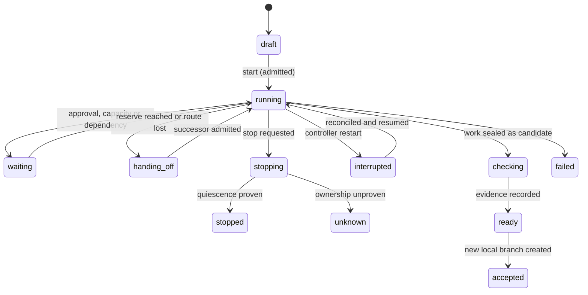

# Architecture

This page describes the current design. The reasoning behind each choice is in the [ADRs](adr/README.md).

## Components

| Component | Owns | Does not own |
|-----------|------|--------------|
| `apps/controller` | State, policy, routing, provider adapters, execution host, artifacts, evidence | Trust in model output as authority |
| `apps/desktop` | Electron main and preload, React renderer, native pickers, a narrow bridge to the client | Database access, provider launches, arbitrary shell or file APIs |
| `apps/cli` | Human commands, JSON output, offline diagnostics | A second permission, acceptance or database write path |
| `packages/contracts` | Runtime schemas, state and reason vocabularies, fixture contracts | Electron, database or provider code |
| `packages/client` | Handshake, typed commands, reconnect and replay, bounded reads | Domain transitions, provider protocols |
| `packages/testkit` | Fake provider executables, synthetic repositories, injected clocks, fault fixtures | Any production inference route |

Provider adapters stay inside the controller until a second consumer needs them. One integration owner lands changes to contracts, migrations, the lockfile and entry points, so the packages never drift apart.

## Processes and transport

The controller runs as one headless Node process per user. The desktop app and the CLI connect to it over a private Unix domain socket using length-prefixed JSON frames with a size limit.

- The socket lives in a directory only the user can read. Each connection presents a token from a user-only file during the handshake.
- The controller binds the actor to the connection. A caller-supplied actor ID is correlation data only.
- Provider processes and workers never receive the socket path or token.
- Clients that speak a different protocol version are rejected.

These measures keep other clients and workers off the control channel. They do not defend against malware running as the same user, and the docs make no such claim.

## Commands and events

Every mutation carries a protocol version, an idempotency key, the expected entity revision and a validated payload. The controller stores a digest of each request with its receipt.

- Retrying the same key with the same content returns the stored result.
- Reusing a key with different content is rejected.
- A stale revision returns `stale-revision` with the current state.

Results use a finite set of outcomes: `applied`, `already-applied`, `stale-revision`, `denied`, `unsupported`, `blocked` and `outcome-unknown`. Each carries a reason code and the safe next action.

Reads use snapshot plus subscription. `GetSnapshot` returns state at cursor C, and `Subscribe` replays ordered events after C. A gap in retained history forces a fresh snapshot. Slow clients are disconnected and resync; they never hold up work.

The command set for the first release:

| Command | Contract |
|---------|----------|
| `RegisterProject`, `InspectSource` | Explicit path selection, base revision, dirty and untracked counts, stable project ID |
| `CreateTask`, `AmendTask`, `PrepareRun` | Saved criteria, versioned amendments, a frozen preview of source, routes, checks and limits |
| `StartRun`, `GetSnapshot`, `Subscribe` | Atomic admission, consistent state with ordered events, no duplicate dispatch |
| `PauseAdmissions`, `StopRun` | Pausing stops new dispatch. Stopping requests cancellation and waits for proven quiescence |
| `ResolveApproval` | Binds the exact pending action, target, attempt, generation and revision |
| `GetChanges`, `GetArtifact`, `GetUsage` | Bounded reads of immutable content and sourced usage observations |
| `AcceptCandidate` | Eligible candidate, current authority, an unused destination ref, idempotent publication |
| `GetHealth`, `ExportDiagnostics` | Runtime and qualification state, redacted export after preview |

The controller exposes registered project and artifact IDs. It exposes no generic exec, raw path, URL fetch or credential command.

## State

Current-state tables in SQLite are authoritative. An ordered event log explains each transition. Large outputs and source snapshots are immutable files addressed by hash.

| Entity | Meaning |
|--------|---------|
| Project | A registered repository with stable identity |
| Task | A bounded outcome with acceptance criteria |
| Run | A frozen revision of a task and its resolved policy |
| Attempt | One dispatch to one route, with a generation number |
| Route | A qualified combination of client, account, model, effort and billing mode |
| Observation | One usage reading for one route window, with source and time |
| Reservation | Capacity the controller holds for admitted work |
| Approval | A pending or resolved decision bound to one exact action |
| Artifact | Immutable content: diffs, logs, snapshots, handoff packets |
| Candidate | A sealed set of changes with a content hash |
| Receipt | The durable record of a command or effect |

A task moves through these visible states:



`unknown` blocks sealing, takeover, cleanup and acceptance until the controller proves no writer remains.

## Admission

Admission is one short SQLite transaction that runs before any provider I/O:

1. Compare the task revision and the caller's authority.
2. Reserve every hard counter and the completion allowance the policy needs.
3. Acquire the writer lease for the task.
4. Record the launch intent, advance state and store the receipt.

The process spawns after the commit. If the controller restarts with an intent that has no acknowledgment, the attempt becomes `outcome-unknown`. Nothing replays it automatically, and nothing refunds reservations on a guess.

## Execution and source safety

Each writer works in an independent scratch copy of a selected committed base. The copy has no shared writable Git metadata, hooks or ambient configuration from the source repository.

- Dirty and untracked files in the user's checkout are disclosed, preserved and left alone.
- Traversal, collisions, unsupported symlinks, submodules and unexpected file modes are rejected with a reason.
- Stopping forwards the client's native interrupt and waits for evidence that every owned writer has exited. A child exit code or a quiet directory alone is not that evidence.

## Evidence and acceptance

After quiescence, the controller imports the scratch changes, hashes them and stores an immutable candidate. Checks and reviews bind to the exact candidate hash, check definition and evaluator. Changing one byte, shrinking the collected test set or altering the evaluator invalidates the evidence that depended on it.

Accepting a candidate creates one new local branch in the source repository with create-if-absent semantics. Existing refs are never overwritten. After a crash, the controller reconciles the exact prepared ref before it reports `already-applied` or a conflict. Acceptance never merges, pushes or deploys.

## Desktop security

The renderer treats all provider content as inert text. The window runs with context isolation and sandboxing, a narrow preload API, sender and argument validation, restricted navigation and controlled external links.

## Repository layout

```text
apps/
  controller/   headless controller: store, domain, routing, continuity, host, providers
  desktop/      Electron main, preload and React renderer
  cli/          command-line client
packages/
  contracts/    schemas and vocabularies shared by every process
  client/       socket client used by desktop and CLI
  testkit/      fakes, fixtures and the synthetic repository
docs/           public documentation and ADRs
scripts/        repository policy checks
```
